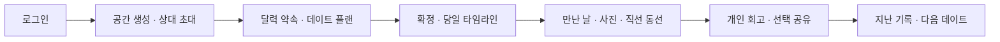
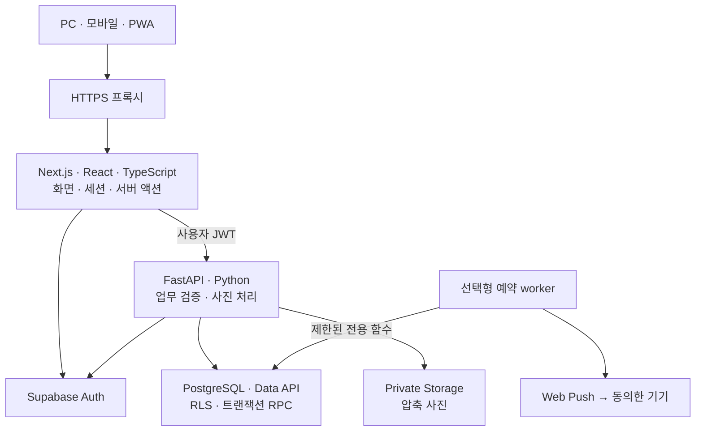
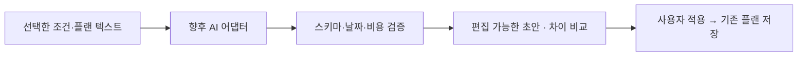

# WE2DAY

**둘의 일정과 만남, 함께 남기는 기록.**

WE2DAY는 두 사람이 함께 사용하는 커플용 웹/PWA입니다. 월 달력에서 약속을 정하고, 데이트를 준비하고, 만난 날의 사진·동선·회고를 이어서 남깁니다. PC와 모바일에서 같은 공간을 사용하며 자신의 Supabase 프로젝트와 서버에 설치해 운영할 수 있습니다.

[시작하기](#quickstart) · [화면](#screens) · [사용법](#usage) · [설치 가이드](guides/setup.md) · [배포 가이드](guides/deployment.md) · [아키텍처](guides/architecture.md) · [AI 로드맵](guides/ai-roadmap.md)

<a id="screens"></a>

## 화면 미리보기

아래는 **격리된 테스트 환경의 가상 일정·기념일·생성 예시 사진**으로 캡처한 실제 화면입니다. 실제 사용자의 계정·사진·이동 기록은 포함하지 않습니다. 설치 환경의 공개 데모 서버는 제공하지 않으며, 저장 없는 미리보기는 로컬 `/preview`에서 볼 수 있습니다.

### 일정이 중심인 홈


날짜를 고르면 해당 날의 약속과 만남 기록을 확인합니다. 다음 약속과 기념일은 위에서 간단히 챙기고, 지도는 필요한 상세 화면에서 펼칩니다.

<table>
  <tr>
    <th>모바일 · 웜 클린</th>
    <th>모바일 · 화이트</th>
    <th>날짜별 사진과 월간 추억</th>
  </tr>
  <tr>
    <td></td>
    <td></td>
    <td></td>
  </tr>
</table>

### 준비한 플랜을 확인하고 확정


초안을 함께 편집하고 확정할 때 달력 약속 하나와 연결합니다. 실제 만남과 방문 완료는 직접 기록합니다.

## 무엇을 할 수 있나요?

| 영역 | 현재 제공하는 기능 |
| --- | --- |
| 둘의 공간 | 지정 아이디·비밀번호, 선택 Google/Kakao 로그인, 초대 기반 두 계정 연결 |
| 일정·기념일 | 월 달력, 공동 약속, 디데이, 양력 기념일, 다가오는 일정, 캘린더 파일 내보내기 |
| 데이트 준비 | 수동 플랜, 활동 순서·시간·예산·장소·준비물, 위시리스트, 확정/재확정·보관/복원 |
| 당일 진행 | 확정차수별 타임라인, 예정·방문 완료·건너뜀의 공동 표시 |
| 만남·동선 | 만난 날짜와 공동 메모, 날짜별 출발/도착 두 점, 직선 지도, 기간별 조회·GeoJSON |
| 사진·추억 | 압축 사진 업로드·공유, 날짜별 앨범, 검색·원본 찾기 참고 정보, 휴지통/복구·선택 ZIP |
| 회고 | 플랜별 템플릿, 각자 개인 초안, 명시적 공유·철회, 작성자 수정 |
| 함께 | 공동 목록·목표, 직접 질문과 개인 답변, 후보 룰렛, 각자의 시간대 보조 |
| 기기·설정 | 웜 클린/화이트, PWA 설치 안내, 오프라인 연결 안내, 선택 기기 알림 |
| 기록 사본 | 권한 범위의 JSON 내보내기·오프라인 손상 검사, 로컬 파일 암호화·원본 대조 도구 |

장소 검색·지도·Push는 공급자/서버 설정이 필요합니다. 기념일 자동 알림은 별도 예약 worker와 **본인 기기의 직접 동의**가 모두 필요합니다. AI 플랜 생성, 사진/일정의 오프라인 편집, 영상 타임랩스, 네이티브 OS 위젯과 전체 DB·사진 자동 백업/복원은 현재 제공하지 않습니다.

<a id="quickstart"></a>

## 빠르게 둘러보기

Docker의 Linux 컨테이너 환경이 있으면 로컬 미리보기를 실행할 수 있습니다. 실제 계정과 기록 저장은 다음 절의 Supabase 설정을 완료한 뒤 사용합니다.

```sh
git clone https://github.com/jhpark-jarvis/we2day.git
cd we2day
cp apps/web/.env.example apps/web/.env
cp apps/api/.env.example apps/api/.env
docker compose up --build --detach
```

- [가상 화면 미리보기](http://127.0.0.1:3000/preview): 저장되지 않는 예시 일정·생성 사진
- [앱](http://127.0.0.1:3000/): 설정 후 로그인·공간 연결
- [API 상태](http://127.0.0.1:8000/health/live): 프로세스 응답 확인

종료는 저장소 루트에서 `docker compose down`을 실행합니다. 클라우드 DB나 사진을 지우는 명령이 아닙니다. 로컬 Compose의 웹/API 포트는 loopback에만 열립니다.

### 실제로 사용하려면

1. 자신의 **Supabase 프로젝트**를 만듭니다.
2. [SQL 마이그레이션](supabase/migrations/202610190001_shared_calendar.sql)의 `001`부터 `024`까지를 **파일명 순서대로, 각각 전체 실행**합니다. 전체 파일 목록은 설치 가이드에 있습니다. 기존 설치에는 아직 적용하지 않은 파일만 실행합니다.
3. 웹/API `.env`에 같은 프로젝트의 URL과 publishable key를 넣습니다.
4. 지정 계정 두 개를 만들거나 선택 소셜 공급자를 설정합니다.
5. 앱을 재생성하고 로그인한 뒤 공간을 만들고 상대를 초대합니다.

계정 생성·전체 SQL 순서·오류 해결·Google/Kakao·NAVER 설정은 [설치 가이드](guides/setup.md)에 모았습니다. 처음 Supabase를 사용하는 경우 이 순서대로 진행하세요.

### 로그인은 설치자가 선택

웹 환경 변수 `WE2DAY_AUTH_PROVIDERS`에 설정한 방식만 화면과 서버에서 사용합니다.

| 운영 방식 | 값 |
| --- | --- |
| 미리 만든 아이디·비밀번호만 | `password` |
| 소셜 로그인만 | `google,kakao` 또는 필요한 공급자 하나 |
| 두 방식 함께 | `password,google,kakao` |
| 로그인 방식 비활성화 | 명시적인 빈 값 |

아이디 계정은 Supabase Auth에 `아이디@login.we2day.invalid` 내부 주소로 생성합니다. 앱에는 아이디만 입력하며 실제 이메일을 받거나 인증 메일을 보내지 않습니다. 공개 회원가입·아이디 변경·계정 병합·메일 비밀번호 복구 UI는 없습니다. 자세한 생성 절차는 [지정 계정 설정](guides/setup.md#password-accounts)을 참고하세요.

<a id="usage"></a>

## 두 사람이 사용하는 흐름



1. **연결:** 한 사람이 공간을 만들고 초대 코드를 발급합니다. 상대는 자신의 계정으로 로그인해 코드를 수락합니다.
2. **일정:** 달력 날짜를 선택하고 약속을 추가합니다. 기념일 관리에서 관계 시작일·생일·직접 정한 기념일을 기록합니다.
3. **준비:** 일정 도구의 플랜에서 활동·예산·준비물을 적고 확정합니다. 초안은 달력에 올라가지 않습니다.
4. **만남:** 타임라인에서 활동 진행을 직접 표시하고, 만난 날·메모·사진·출발/도착점을 남깁니다.
5. **회고:** 각자 리포트를 작성하고 원하는 시점에 공유합니다. 기록 검색·월간 추억·사본 내보내기로 다시 찾아봅니다.

하단/상단의 **일정 · 함께 · 기록 · 설정**이 주요 메뉴입니다. 함께는 목록/목표/질문/룰렛, 기록은 사진·검색·동선·사본, 설정은 테마·앱 설치·기기 알림·시간대·계정에 사용합니다.

> 동선은 출발점과 도착점을 직선으로 잇는 기록입니다. 실시간 위치 추적이나 실제 도로 주행경로가 아니며, 지도 열기/플랜 확정만으로 실제 만남을 자동 기록하지 않습니다.

## 시스템 구성



| 계층 | 현재 스택 |
| --- | --- |
| 웹 | Node.js 24, Next.js 16 App Router, React 19, TypeScript 5.9 |
| UI | CSS 변수·반응형 공통 컴포넌트, Tailwind CSS 4 구성, Lucide |
| API | Python 3.13, FastAPI, Pydantic, HTTPX, Pillow |
| 데이터·인증·사진 | Supabase Auth, PostgreSQL, Data API/PostgREST, Private Storage |
| 선택 연동 | NAVER API HUB 지역 검색, NAVER Maps, Web Push |
| 실행·검증 | Docker Compose, uv, npm workspace, Ruff, pytest, Biome, Playwright |

서버 액션과 API는 현재 사용자 JWT로 요청하고 SQL/RLS가 같은 공간의 접근을 검사합니다. 업무용 관리자 키를 브라우저나 일반 업무 API에 넣지 않습니다. 사진은 압축본을 비공개 Storage에 저장하며 개인 회고/답변은 명시적 공유 전까지 작성자만 접근합니다.

현재 실행 단위·로그인 시퀀스·데이터 연결·사진 수명주기·예약 알림·성능/PWA 범위는 [아키텍처 가이드](guides/architecture.md)에서 설명합니다. 정확한 의존성은 `package-lock.json`과 `apps/api/uv.lock`에 고정합니다.

## 자신의 서버에 배포

이 저장소는 호스팅 계정이나 운영 자격 정보를 포함하지 않습니다. 각 설치자가 자신의 도메인·서버·Supabase 프로젝트를 준비합니다.

| 순서 | 할 일 |
| --- | --- |
| 1 | [초기 설정](guides/setup.md)으로 DB·로그인·환경 파일 준비 |
| 2 | 같은 소스 버전의 웹/API Linux 이미지 빌드·검증 |
| 3 | 전용 VM 디렉터리에 이미지와 공개 Compose 예시 전달 |
| 4 | 비공개 `api.env`·`web.env`·Compose `.env` 구성 |
| 5 | 웹 loopback·API 내부망 상태 확인 후 HTTPS 프록시 연결 |
| 6 | Supabase redirect·NAVER 허용 origin을 운영 주소에 맞춤 |
| 7 | 두 계정 로그인·사진·설치·기기 알림과 복구 절차 확인 |

개발용 `compose.yaml`과 운영용 [`compose.vm.yaml`](apps/api/deployment/compose.vm.yaml)은 별도로 사용합니다. 운영 Compose는 웹만 loopback `3200`에 바인딩하고 API는 내부망에 둡니다. 공개 접속은 HTTPS 프록시를 거칩니다. 빌드·전송·환경 변수·TLS·갱신·예약 알림·백업·실패 복구의 실제 절차는 [배포 가이드](guides/deployment.md)를 따르세요.

### 휴대폰에서 사용

- **iPhone/iPad:** HTTPS 주소를 Safari에서 열고 공유 메뉴 → 홈 화면에 추가 → 추가한 아이콘으로 실행합니다.
- **Android:** 지원 브라우저의 앱 설치/홈 화면 추가 메뉴를 사용합니다.
- **알림:** 설치와 별도로 설정에서 본인 기기 알림을 켭니다. 자동 기념일 알림도 별도로 동의합니다. 기기·OS·네트워크에 따라 도착이 달라질 수 있습니다.

## AI와 고도화 방향

**현재 AI 기능은 미구현**입니다. 현재의 수동 플랜 템플릿과 저장/확정 흐름 위에 아래 단계를 붙이는 방향을 검토합니다.



첫 단계는 날짜·예산·교통·희망 활동을 기존 플랜 템플릿으로 정리하는 기능입니다. 이후 부분 수정 제안, 이용 조건을 확인한 제한 도구, 선택한 메모의 회고 보조, 명시적으로 선택한 과거 기록 활용을 검토합니다.

공급자는 미정이며 AI가 DB를 직접 쓰거나 일정 확정·공유·삭제를 자동 실행하도록 만들지 않습니다. 입력 최소화·사용 상한·실패 시 수동 편집·권한/구조 검증과 단계별 완료 기준은 [AI 구현 로드맵](guides/ai-roadmap.md)에 상세히 설명했습니다. 영상 타임랩스·전체 백업/복원·추가 연결 기능도 각각의 저장/복구·기기 검증을 거쳐 확장할 범위입니다.

## 개발과 검증

Docker 대신 로컬 런타임으로 실행할 수도 있습니다. Node.js 24.15 이상 24.x, npm 11, Python 3.13, uv를 준비합니다.

```sh
npm ci
uv sync --project apps/api --locked
npm run dev
# 다른 터미널
npm run dev:api
```

```sh
npm run typecheck
npm run lint
npm run lint:api
npm run test:api
```

실제 SQL/RLS·브라우저 종단 검사는 Docker와 Playwright 브라우저가 필요합니다. 선택 실행 명령과 준비 사항은 [검사 안내](guides/setup.md#checks)에 있습니다. 문서 화면은 `npm run screenshots`로 격리된 합성 DB/Auth/Storage에서 다시 캡처할 수 있습니다. 실제 Supabase 계정이나 운영 데이터로 캡처하지 않습니다.

`.env`, 자격 파일, 개인 사진/내보내기, 런타임·검증 생성물은 공개 커밋에 넣지 마세요. 예제 파일만 복사해 자신의 값으로 설정합니다.
