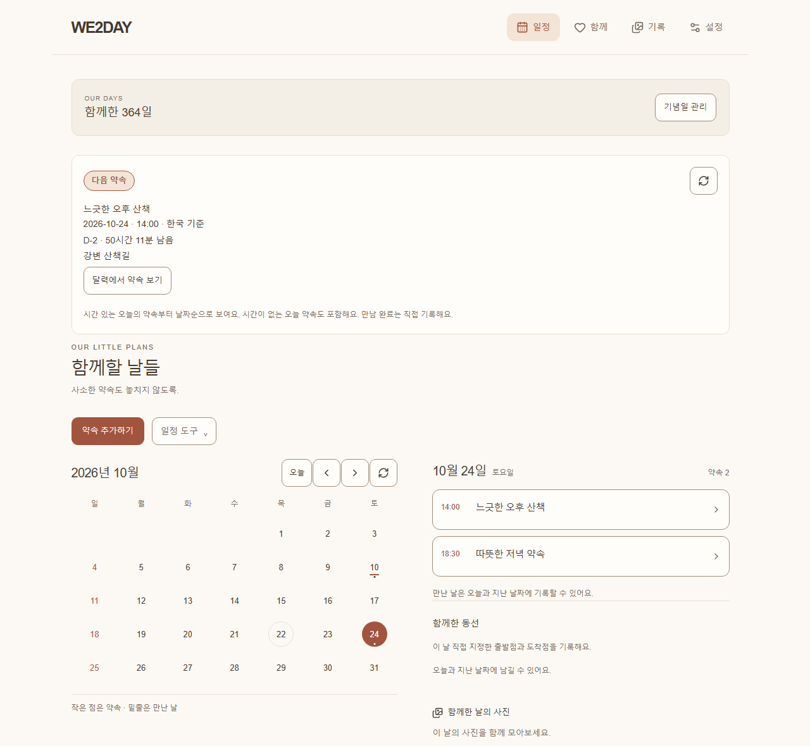
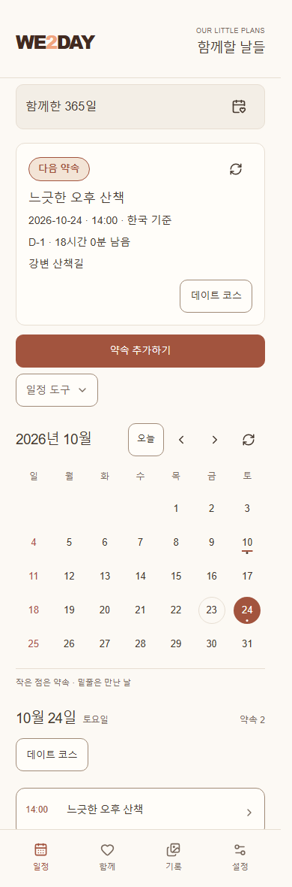
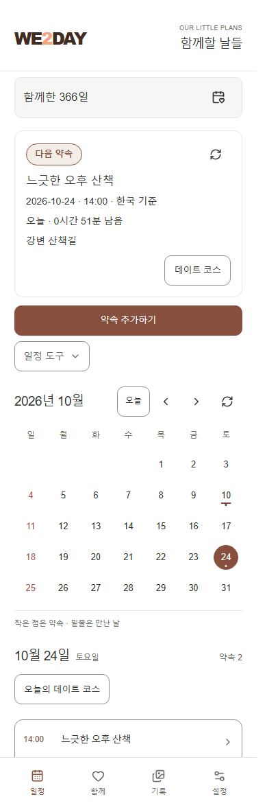
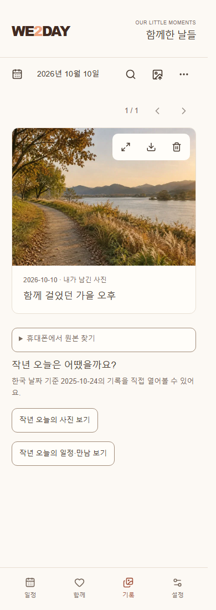
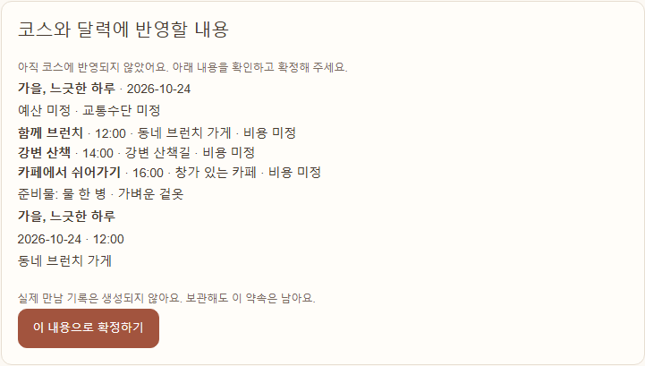
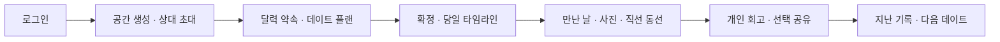
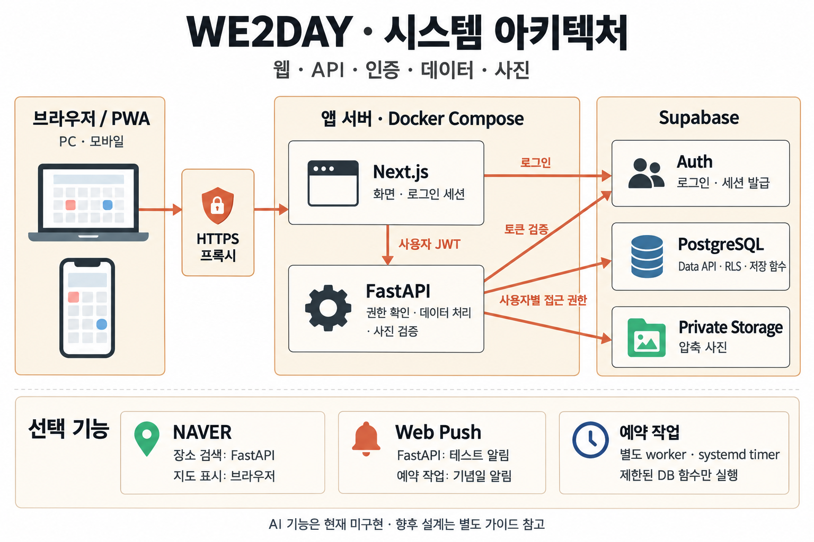
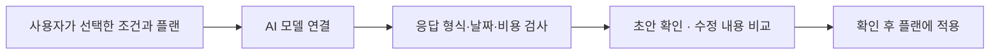

# WE2DAY

**둘의 약속을 정하고, 함께한 날을 기록해요.**

WE2DAY는 연인이 함께 일정과 추억을 관리하는 웹앱입니다. 달력에 약속을 잡고, 데이트 계획을 세우고, 만난 날의 사진과 동선, 후기를 남길 수 있습니다. PC와 모바일에서 같은 기록을 확인하며, 휴대폰 홈 화면에 추가해 앱처럼 사용할 수도 있습니다. 직접 운영하려면 자신의 서버와 Supabase 프로젝트에 설치하면 됩니다.

[시작하기](#quickstart) · [화면](#screens) · [사용법](#usage) · [설치 가이드](guides/setup.md) · [배포 가이드](guides/deployment.md) · [아키텍처](guides/architecture.md) · [AI 로드맵](guides/ai-roadmap.md)

<a id="screens"></a>

## 화면 미리보기

아래 화면은 테스트용 일정과 기념일, AI로 만든 예시 사진을 넣어 촬영했습니다. 실제 사용자의 계정이나 사진, 이동 기록은 사용하지 않았습니다. 공개 체험 서버는 제공하지 않습니다. 로컬에서 실행한 뒤 `/preview`에 접속하면 데이터를 저장하지 않고 예시 화면을 둘러볼 수 있습니다.

### 일정이 중심인 홈



날짜를 고르면 해당 날의 약속과 만남 기록을 확인합니다. 화면 위쪽에는 다음 약속과 기념일이 표시됩니다. 지도는 약속이나 동선을 확인할 때 필요한 화면에서 열 수 있습니다.

<table>
  <tr>
    <th>모바일 · 웜 클린</th>
    <th>모바일 · 화이트</th>
    <th>날짜별 사진과 월간 추억</th>
  </tr>
  <tr>
    <td></td>
    <td></td>
    <td></td>
  </tr>
</table>

### 데이트 계획을 함께 작성하고 확정



플랜 초안은 두 사람이 함께 수정할 수 있습니다. 내용을 확인하고 확정하면 달력에 약속 하나로 등록됩니다. 실제로 만났는지, 각 장소를 방문했는지는 별도로 표시합니다.

## 무엇을 할 수 있나요?

| 영역 | 현재 제공하는 기능 |
| --- | --- |
| 둘의 공간 | 미리 만든 아이디로 로그인, Google/Kakao 로그인 선택, 초대 코드로 두 계정 연결 |
| 일정·기념일 | 월별 달력, 공동 일정, 디데이, 양력 기념일, 다가오는 일정, 캘린더 파일 다운로드 |
| 데이트 준비 | 데이트 플랜 작성, 활동 순서·시간·예산·장소·준비물, 위시리스트, 플랜 확정·보관·복원 |
| 당일 진행 | 확정한 플랜의 타임라인, 활동별 예정·방문 완료·건너뜀 표시 |
| 만남·동선 | 만난 날과 메모, 출발점·도착점을 직선으로 연결한 지도, 기간별 동선 조회·GeoJSON 다운로드 |
| 사진·추억 | 사진 압축·업로드·공유, 날짜별 앨범, 사진 검색, 휴대폰에서 원본을 찾기 위한 파일 정보, 휴지통·복구·ZIP 다운로드 |
| 회고 | 플랜별 후기 템플릿, 개인 초안, 직접 공유·공유 취소, 작성자만 수정 |
| 함께 | 공동 목록과 목표, 직접 작성하는 질문과 답변, 선택 룰렛, 각자의 현지 시각 표시 |
| 기기·설정 | 웜 클린·화이트 테마, 홈 화면 설치 안내, 연결이 끊겼을 때의 안내 화면, 기기 알림 설정 |
| 기록 사본 | 조회할 수 있는 기록의 JSON 다운로드, 파일 손상 확인, 로컬 파일 암호화·원본 비교 |

장소 검색과 지도, 푸시 알림은 별도 설정을 마쳐야 사용할 수 있습니다. 기념일 자동 알림은 서버에 예약 작업을 설정한 뒤, 알림을 받을 기기에서도 직접 켜야 합니다. AI 플랜 생성, 사진/일정의 오프라인 편집, 영상 타임랩스, 네이티브 OS 위젯과 전체 DB·사진 자동 백업/복원은 현재 제공하지 않습니다.

<a id="quickstart"></a>

## 빠르게 둘러보기

Docker에서 Linux 컨테이너를 실행할 수 있다면 아래 명령으로 시작할 수 있습니다. 계정으로 로그인하고 기록을 저장하려면 다음 절의 Supabase 설정도 완료해야 합니다.

```sh
git clone https://github.com/jhpark-jarvis/we2day.git
cd we2day
cp apps/web/.env.example apps/web/.env
cp apps/api/.env.example apps/api/.env
docker compose up --build --detach
```

- [가상 화면 미리보기](http://127.0.0.1:3000/preview): 저장되지 않는 예시 일정·생성 사진
- [앱](http://127.0.0.1:3000/): 설정 후 로그인·공간 연결
- [API 상태](http://127.0.0.1:8000/health/live): 프로세스 응답 확인

종료할 때는 저장소 루트에서 `docker compose down`을 실행합니다. Supabase에 저장한 데이터와 사진은 유지됩니다. 로컬 실행 시 웹과 API에는 같은 PC에서만 접속할 수 있습니다.

### 실제로 사용하려면

1. 자신의 **Supabase 프로젝트**를 만듭니다.
2. [SQL 마이그레이션](supabase/migrations/202610190001_shared_calendar.sql)의 `001`부터 `024`까지를 **파일명 순서대로, 각각 전체 실행**합니다. 전체 파일 목록은 설치 가이드에 있습니다. 기존 설치에는 아직 적용하지 않은 파일만 실행합니다.
3. 웹/API `.env`에 같은 프로젝트의 URL과 publishable key를 넣습니다.
4. 지정 계정 두 개를 만들거나 선택 소셜 공급자를 설정합니다.
5. 앱을 재생성하고 로그인한 뒤 공간을 만들고 상대를 초대합니다.

계정 생성·전체 SQL 순서·오류 해결·Google/Kakao·NAVER 설정은 [설치 가이드](guides/setup.md)에 모았습니다. 처음 Supabase를 사용하는 경우 이 순서대로 진행하세요.

### 사용할 로그인 방식 선택

운영자는 웹 환경 변수 `WE2DAY_AUTH_PROVIDERS`로 사용할 로그인 방식을 정합니다. 설정한 방식만 로그인 화면에 표시됩니다.

| 운영 방식 | 값 |
| --- | --- |
| 미리 만든 아이디·비밀번호만 | `password` |
| 소셜 로그인만 | `google,kakao` 또는 필요한 공급자 하나 |
| 두 방식 함께 | `password,google,kakao` |
| 로그인 방식 비활성화 | 빈 문자열 (`WE2DAY_AUTH_PROVIDERS=`) |

아이디 계정은 Supabase Auth에 `아이디@login.we2day.invalid` 내부 주소로 생성합니다. 앱에는 아이디만 입력하며 실제 이메일을 받거나 인증 메일을 보내지 않습니다. 공개 회원가입·아이디 변경·계정 병합·메일 비밀번호 복구 UI는 없습니다. 자세한 생성 절차는 [지정 계정 설정](guides/setup.md#password-accounts)을 참고하세요.

<a id="usage"></a>

## 두 사람이 사용하는 흐름



1. **연결:** 한 사람이 공간을 만들고 초대 코드를 발급합니다. 상대는 자신의 계정으로 로그인해 코드를 수락합니다.
2. **일정:** 달력 날짜를 선택하고 약속을 추가합니다. 기념일 관리에서 관계 시작일·생일·직접 정한 기념일을 기록합니다.
3. **준비:** 일정 도구의 플랜에서 활동·예산·준비물을 적고 확정합니다. 초안은 달력에 올라가지 않습니다.
4. **만남:** 타임라인에서 활동 진행을 직접 표시하고, 만난 날·메모·사진·출발/도착점을 남깁니다.
5. **회고:** 각자 리포트를 작성하고 원하는 시점에 공유합니다. 기록 검색·월간 추억·사본 내보내기로 다시 찾아봅니다.

주요 메뉴는 **일정 · 함께 · 기록 · 설정**입니다. PC에서는 화면 위쪽, 모바일에서는 아래쪽에 표시됩니다. 함께에서는 목록·목표·질문·룰렛을, 기록에서는 사진·검색·동선·기록 다운로드를 사용할 수 있습니다. 설정에서는 테마·앱 설치·알림·시간대·계정을 관리합니다.

> 동선은 출발점과 도착점을 직선으로 잇는 기록입니다. 실시간 위치 추적이나 실제 도로 주행경로가 아니며, 지도 열기/플랜 확정만으로 실제 만남을 자동 기록하지 않습니다.

## 시스템 구성



앱의 현재 구성을 정리한 이미지입니다. 아래쪽의 지도·알림·예약 작업은 필요한 경우에만 설정하는 선택 기능입니다. AI는 현재 실행 구조에 포함되지 않습니다.

| 구분 | 사용 기술 |
| --- | --- |
| 웹 | Node.js 24, Next.js 16 App Router, React 19, TypeScript 5.9 |
| UI | CSS 변수·반응형 공통 컴포넌트, Tailwind CSS 4 구성, Lucide |
| API | Python 3.13, FastAPI, Pydantic, HTTPX, Pillow |
| 데이터·인증·사진 | Supabase Auth, PostgreSQL, Data API/PostgREST, Private Storage |
| 선택 기능 | NAVER API HUB 지역 검색, NAVER Maps, Web Push |
| 실행·검증 | Docker Compose, uv, npm workspace, Ruff, pytest, Biome, Playwright |

Next.js는 로그인한 사용자의 인증 토큰(JWT)을 FastAPI에 전달합니다. FastAPI는 토큰을 확인하고, 데이터베이스의 행 단위 보안(RLS)은 사용자가 속한 공간의 데이터만 허용합니다. 사진은 비공개 저장소에 압축본으로 보관합니다. 개인 후기와 답변은 작성자가 공유하기 전까지 상대방에게 보이지 않습니다.

구성 요소별 역할, 로그인 과정, 데이터 관계, 사진 저장·삭제, 자동 알림과 PWA 지원 범위는 [아키텍처 가이드](guides/architecture.md)에서 설명합니다. 정확한 의존성은 `package-lock.json`과 `apps/api/uv.lock`에 고정합니다.

## 자신의 서버에 배포

직접 운영하려면 도메인, 서버, Supabase 프로젝트를 준비해야 합니다. 계정과 인증 정보는 자신의 환경에 따로 설정합니다.

| 순서 | 할 일 |
| --- | --- |
| 1 | [초기 설정](guides/setup.md)으로 DB·로그인·환경 파일 준비 |
| 2 | 같은 소스 버전의 웹/API Linux 이미지 빌드·검증 |
| 3 | 전용 VM 디렉터리에 이미지와 공개 Compose 예시 전달 |
| 4 | 비공개 `api.env`·`web.env`·Compose `.env` 구성 |
| 5 | 서버 내부에서 웹·API 실행 확인 후 HTTPS 연결 |
| 6 | Supabase 로그인 복귀 주소와 NAVER 허용 주소 등록 |
| 7 | 두 계정의 로그인·사진 공유, 휴대폰 설치·알림, 복구 절차 확인 |

개발용 `compose.yaml`과 운영용 [`compose.vm.yaml`](apps/api/deployment/compose.vm.yaml)은 별도로 사용합니다. 운영 Compose는 웹을 서버의 `127.0.0.1:3200`에서 실행하고, API는 Docker 내부 네트워크에서만 접근하도록 구성합니다. 공개 접속은 HTTPS 프록시를 거칩니다. 빌드·전송·환경 변수·TLS·갱신·예약 알림·백업·실패 복구의 실제 절차는 [배포 가이드](guides/deployment.md)를 따르세요.

### 휴대폰에서 사용

- **iPhone/iPad:** HTTPS 주소를 Safari에서 열고 공유 메뉴 → 홈 화면에 추가 → 추가한 아이콘으로 실행합니다.
- **Android:** 지원 브라우저의 앱 설치/홈 화면 추가 메뉴를 사용합니다.
- **알림:** 설치와 별도로 설정에서 본인 기기 알림을 켭니다. 자동 기념일 알림도 별도로 동의합니다. 기기·OS·네트워크에 따라 도착이 달라질 수 있습니다.

## AI와 고도화 방향

**현재 AI 기능은 미구현**입니다. 현재 플랜 작성·저장·확정 기능에 AI가 초안을 제안하는 단계를 추가하는 방안을 검토하고 있습니다. 아래 내용은 향후 설계 제안이며, 모델과 공급자는 아직 정하지 않았습니다.



먼저 날짜·예산·교통수단·희망 활동을 플랜 초안으로 정리하는 기능을 검토합니다. 이후에는 플랜의 일부 수정 제안, 장소 검색 등 추가 도구 연결, 선택한 메모로 후기 작성 돕기, 지난 기록을 활용한 추천으로 확장할 수 있습니다. 도구 연결 전에는 각 서비스의 이용 조건을 확인해야 합니다.

AI가 데이터베이스를 직접 수정하거나 일정을 자동 확정·공유·삭제하는 방식은 도입하지 않을 계획입니다. 전송할 데이터, 사용량 제한, 실패 시 처리 방법, 단계별 구현 목표는 [AI 구현 로드맵](guides/ai-roadmap.md)에 상세히 설명했습니다. 영상 타임랩스와 전체 자동 백업·복원 등도 향후 확장 후보입니다. 현재는 서버에서 DB·사진을 수집하는 도구와 암호화 묶음, 무결성 검사, 새 디렉터리 파일 복구 도구를 제공합니다. 사용 방법과 실제 전체 복원 검증의 범위는 [백업 안내](guides/deployment.md#backup-bundles)를 참고하세요.

## 개발과 검증

Docker 대신 로컬 런타임으로 실행할 수도 있습니다. Node.js 24.15 이상 24.x, npm 11, Python 3.13, uv를 준비합니다.

```sh
npm ci
uv sync --project apps/api --locked
npm run dev
# 다른 터미널
npm run dev:api
```

```sh
npm run typecheck
npm run lint
npm run lint:api
npm run test:api
```

데이터베이스 접근 권한(RLS)과 브라우저의 전체 사용 흐름을 검사하려면 Docker와 Playwright 브라우저가 필요합니다. 검사별 실행 명령과 준비 사항은 [검사 안내](guides/setup.md#checks)에 있습니다. README의 화면은 `npm run screenshots`로 다시 만들 수 있습니다. 임시 데이터베이스와 테스트용 인증·사진 저장 서버를 사용하므로 실제 계정이나 운영 데이터가 필요하지 않습니다.

`.env`, 자격 파일, 개인 사진/내보내기, 런타임·검증 생성물은 공개 커밋에 넣지 마세요. 예제 파일만 복사해 자신의 값으로 설정합니다.
