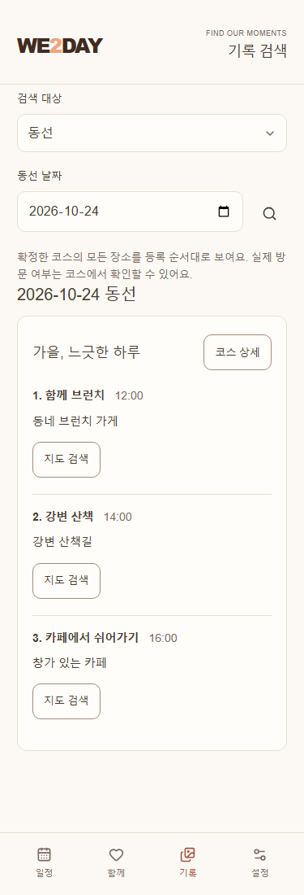
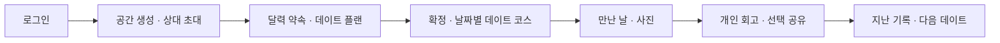
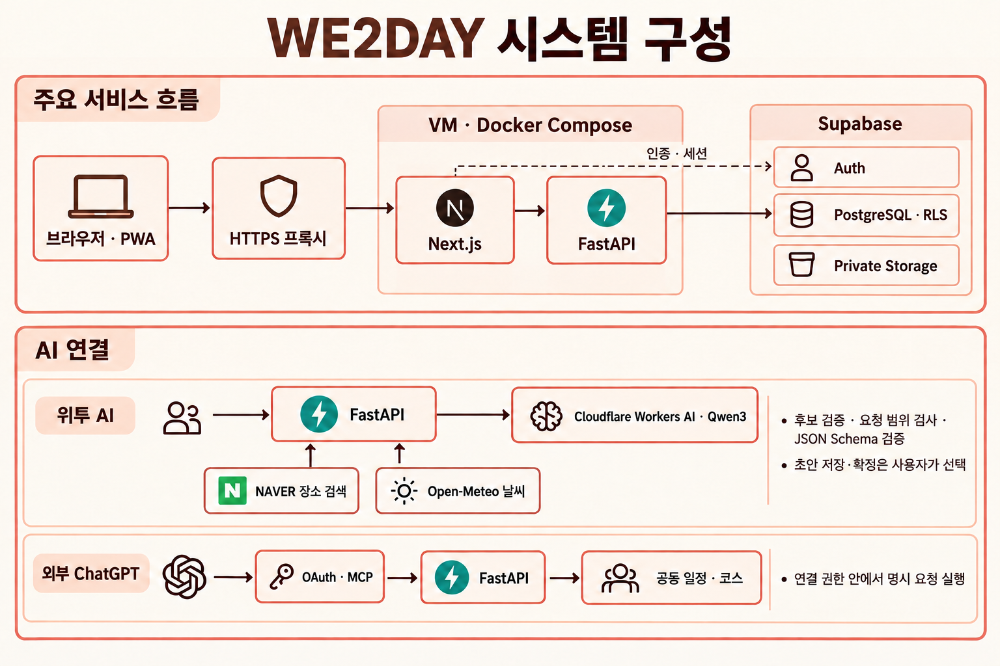
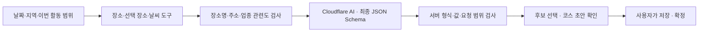

# WE2DAY

**둘의 약속을 정하고, 함께한 날을 기록해요.**

WE2DAY는 연인이 함께 일정과 추억을 관리하는 웹앱입니다. 달력에 약속을 잡고, 데이트 계획을 세우고, 만난 날의 사진과 후기를 남길 수 있습니다. PC와 모바일에서 같은 기록을 확인하며, 휴대폰 홈 화면에 추가해 앱처럼 사용할 수도 있습니다. 직접 운영하려면 자신의 서버와 Supabase 프로젝트에 설치하면 됩니다.

[시작하기](#quickstart) · [화면](#screens) · [사용법](#usage) · [설치 가이드](guides/setup.md) · [배포 가이드](guides/deployment.md) · [장애 복구](guides/recovery.md) · [아키텍처](guides/architecture.md) · [AI 로드맵](guides/ai-roadmap.md) · [에이전트 연결 API](guides/agent-api.md)

<a id="screens"></a>

## 화면 미리보기

아래 화면은 테스트용 일정과 기념일, AI로 만든 예시 사진을 넣어 촬영했습니다. 실제 사용자의 계정이나 사진, 이동 기록은 사용하지 않았습니다. 공개 체험 서버는 제공하지 않습니다. 로컬에서 실행한 뒤 `/preview`에 접속하면 데이터를 저장하지 않고 예시 화면을 둘러볼 수 있습니다.

### 일정이 중심인 홈


날짜를 고르면 해당 날의 약속과 만남 기록을 확인합니다. 화면 위쪽에는 다음 약속과 기념일이 표시됩니다. 저장한 코스의 네이버 지도 버튼으로 목적지를 열 수 있습니다.

<table>
  <tr>
    <th>모바일 · 웜 클린</th>
    <th>모바일 · 화이트</th>
    <th>날짜별 사진 앨범</th>
  </tr>
  <tr>
    <td></td>
    <td></td>
    <td></td>
  </tr>
</table>

### 데이트 계획을 함께 작성하고 확정


플랜 초안은 두 사람이 함께 수정할 수 있습니다. 내용을 확인하고 확정하면 달력에 약속 하나로 등록됩니다. 실제로 만났는지, 각 장소를 방문했는지는 별도로 표시합니다.

### 하루 전체 동선



확정한 코스의 모든 장소를 순서대로 확인하고, 각 장소의 지도 링크를 열 수 있습니다. 별도의 출발·도착 좌표 입력은 필요하지 않습니다.

## 무엇을 할 수 있나요?

| 영역 | 현재 제공하는 기능 |
| --- | --- |
| 둘의 공간 | 미리 만든 아이디로 로그인, Google/Kakao 로그인 선택, 초대 코드로 두 계정 연결 |
| 일정·기념일 | 월별 달력, 공동 약속·개인 일정, 디데이, 양력 기념일, 다가오는 일정, 캘린더 파일 다운로드 |
| 데이트 준비 | 데이트 플랜 작성, 활동 순서·시간·예산·장소·준비물, 위시리스트, 플랜 확정·보관·복원 |
| 당일 진행 | 날짜별 데이트 코스, 저장한 장소의 네이버 지도 앱 연결, 활동별 예정·방문 완료·건너뜀 표시 |
| 만남·하루 동선 | 만난 날과 메모, 날짜별 확정 코스의 모든 활동·장소 순서 조회와 지도 앱 연결 |
| 사진·추억 | 사진 압축·업로드·공유, 날짜별 앨범, 사진 검색, 휴대폰에서 원본을 찾기 위한 파일 정보, 휴지통·복구·ZIP 다운로드 |
| 회고 | 플랜별 후기 템플릿, 개인 초안, 직접 공유·공유 취소, 작성자만 수정 |
| 함께 | 공동 목록과 목표, 위시, 직접 작성하는 질문과 답변, 선택 룰렛, 각자의 현지 시각 표시 |
| 위투 AI | 단계별 조건 입력, 실시간 처리 상태, 장소 카드·지도·선택, 코스 수정, 본인 대화 이어가기 |
| 기기·설정 | 웜 클린·화이트·네 캐릭터 테마, 홈 화면 설치 안내, 연결이 끊겼을 때의 안내 화면, 기기 알림 설정 |
| 기록 사본 | 조회할 수 있는 기록의 JSON 다운로드, 파일 손상 확인, 로컬 파일 암호화·원본 비교 |

장소 검색은 NAVER API HUB 지역 검색으로 장소명·주소 목록을 표시합니다. **장소 선택**을 누르면 해당 약속이나 활동의 장소 입력란에 반영되며, 저장 버튼을 눌러야 기록됩니다. 검색을 사용하려면 API 서버에 검색 키를 설정합니다. 저장한 코스의 네이버 지도 앱 연결에는 별도 검색 키를 사용하지 않습니다. 푸시 알림은 별도 설정이 필요합니다. 기념일 자동 알림은 서버에 예약 작업을 설정한 뒤, 알림을 받을 기기에서도 직접 켜야 합니다. DB·사진의 일별 백업 도구는 운영자가 복구·키 보관을 검토한 뒤 별도로 켜는 구성입니다. 백업 자동 정리는 복구·보존 정책을 검토한 뒤 별도로 활성화합니다. 전체 서비스 자동 복원, 사진/일정의 오프라인 편집, 영상 타임랩스, 네이티브 OS 위젯은 현재 제공하지 않습니다.

**기록 → 검색**에서 사진·약속/플랜/회고/위시·동선·월간 추억을 검색 대상으로 선택합니다. 대상을 바꿔도 해당 화면의 입력과 결과는 유지됩니다. 기록 파일은 **설정 → 기록 내보내기**에서 종류와 기간을 선택해 내려받습니다.

**설정 → 자주 가는 곳**에서 별칭과 장소명·주소를 저장하면 두 사람이 함께 사용할 수 있습니다. 추가·수정 창의 검색 아이콘으로 기존 네이버 장소 검색 결과를 선택하거나 직접 입력합니다. 검색에는 검색 API 키가 필요하며, 직접 입력은 키 없이 사용할 수 있습니다. 약속·코스의 장소 입력 옆 **자주 가는 곳**에서 골라 넣고, 약속이나 플랜은 별도로 저장합니다. 휴지통 아이콘으로 삭제한 장소는 **휴지통**에서 복원할 수 있습니다. 자주 가는 곳에서 삭제해도 기존 약속·코스의 장소는 유지됩니다.

**설정 → 화면 테마**에서 웜 클린·화이트와 네 캐릭터 테마(퐁니 라벤더·두뭉 크림·소푸 버터·쿠쿠 코코아)를 선택합니다. 캐릭터 테마는 배경·버튼·달력의 색감과 로고 옆 작은 캐릭터가 함께 바뀝니다. 선택은 해당 브라우저에 저장됩니다.

WebP 압축이 지원되지 않는 브라우저에서는 사진을 JPEG로 줄이고, 서버에 저장할 때 WebP로 변환합니다. 원본은 전송하지 않으며 압축본의 크기·메타데이터 제한은 동일합니다.

### 개인 일정

홈의 **약속 추가하기 → 개인 일정**에서 제목·날짜와 선택 시간·메모를 등록합니다. 상대방도 작성자 이름과 함께 볼 수 있으며, 수정·삭제는 작성자만 할 수 있습니다. 개인 일정에는 장소·코스·동선이 없습니다. 달력의 점은 공동 약속, 밑줄은 개인 일정, 체크는 만난 날을 뜻하며 같은 날짜에 함께 표시될 수 있습니다. 다음 약속과 에이전트 연결 API에는 공동 약속만 포함합니다.

### 사진 일괄 업로드

기록 탭의 사진 업로드 아이콘에서 한 번에 최대 20장을 선택할 수 있습니다. 앨범 날짜는 공통으로 지정하고 설명은 사진별로 입력합니다. JPEG·PNG·WebP를 한 장당 20MB까지 선택할 수 있으며, 원본 대신 기기에서 만든 압축본만 저장합니다. 사진을 차례로 처리하고 저장 결과를 개별 표시합니다. 일부 저장이 실패하면 성공한 사진은 유지하고 실패한 항목만 같은 요청으로 다시 저장해 중복을 막습니다.

검색·월간 추억·앨범에는 최대 640px 미리보기를 사용해 사진을 가볍게 불러옵니다. 크게 보기와 다운로드는 저장된 압축본의 크기를 유지합니다.

날짜별 앨범은 사진을 가로로 넘겨 봅니다. 크게 보기는 화면 전체에서 사진 비율을 유지하며 중앙에 표시합니다. 날짜 왼쪽 달력 아이콘으로 사진이 있는 날을 선택하고, 우측 업로드 아이콘으로 사진을 추가합니다. 그 옆 다운로드 아이콘에서 사진을 선택해 ZIP으로 내려받을 수 있습니다. 사진 우측 상단에서 크게 보기·압축본 다운로드·휴지통 이동을 선택할 수 있습니다. **설정 → 사진 휴지통**에서 기록 날짜와 사진 기록을 찾아 복구할 수 있으며, 최소 30일 보관 후 확인 문구를 입력하면 영구 삭제할 수 있습니다. 자동 삭제는 하지 않습니다.


<a id="quickstart"></a>

## 빠르게 둘러보기

Docker에서 Linux 컨테이너를 실행할 수 있다면 아래 명령으로 시작할 수 있습니다. 계정으로 로그인하고 기록을 저장하려면 다음 절의 Supabase 설정도 완료해야 합니다.

```sh
git clone https://github.com/jhpark-jarvis/we2day.git
cd we2day
cp apps/web/.env.example apps/web/.env
cp apps/api/.env.example apps/api/.env
docker compose up --build --detach
```

- [가상 화면 미리보기](http://127.0.0.1:3000/preview): 저장되지 않는 예시 일정·생성 사진
- [앱](http://127.0.0.1:3000/): 설정 후 로그인·공간 연결
- [API 상태](http://127.0.0.1:8000/health/live): 프로세스 응답 확인

종료할 때는 저장소 루트에서 `docker compose down`을 실행합니다. Supabase에 저장한 데이터와 사진은 유지됩니다. 로컬 실행 시 웹과 API에는 같은 PC에서만 접속할 수 있습니다.

### 실제로 사용하려면

1. 자신의 **Supabase 프로젝트**를 만듭니다.
2. [SQL 마이그레이션](supabase/migrations/202610190001_shared_calendar.sql)의 `001`부터 `040`까지를 **파일명 순서대로, 각각 전체 실행**합니다. 전체 파일 목록은 설치 가이드에 있습니다. 기존 설치에는 아직 적용하지 않은 파일만 실행합니다.
3. 웹/API `.env`에 같은 프로젝트의 URL과 publishable key를 넣습니다.
4. 지정 계정 두 개를 만들거나 선택 소셜 공급자를 설정합니다.
5. 앱을 재생성하고 로그인한 뒤 공간을 만들고 상대를 초대합니다.

계정 생성·전체 SQL 순서·오류 해결·Google/Kakao·NAVER 설정은 [설치 가이드](guides/setup.md)에 모았습니다. 처음 Supabase를 사용하는 경우 이 순서대로 진행하세요.

### 사용할 로그인 방식 선택

운영자는 웹 환경 변수 `WE2DAY_AUTH_PROVIDERS`로 사용할 로그인 방식을 정합니다. 설정한 방식만 로그인 화면에 표시됩니다.

| 운영 방식 | 값 |
| --- | --- |
| 미리 만든 아이디·비밀번호만 | `password` |
| 소셜 로그인만 | `google,kakao` 또는 필요한 공급자 하나 |
| 두 방식 함께 | `password,google,kakao` |
| 로그인 방식 비활성화 | 빈 문자열 (`WE2DAY_AUTH_PROVIDERS=`) |

아이디 계정은 Supabase Auth에 `아이디@login.we2day.invalid` 내부 주소로 생성합니다. 앱에는 아이디만 입력하며 실제 이메일을 받거나 인증 메일을 보내지 않습니다. 공개 회원가입·아이디 변경·계정 병합·메일 비밀번호 복구 UI는 없습니다. 자세한 생성 절차는 [지정 계정 설정](guides/setup.md#password-accounts)을 참고하세요.

<a id="usage"></a>

## 두 사람이 사용하는 흐름



1. **연결:** 한 사람이 공간을 만들고 초대 코드를 발급합니다. 상대는 자신의 계정으로 로그인해 코드를 수락합니다.
2. **일정:** 달력 날짜를 선택하고 약속을 추가합니다. 기념일 관리에서 관계 시작일·생일·직접 정한 기념일을 기록합니다.
3. **준비:** 달력에서 날짜를 고르고 해당 날짜의 약속 영역에서 **코스 등록**을 누릅니다. 방문할 장소명·주소와 활동 순서·예산·준비물을 적고 저장하면 반영할 내용이 열립니다. 내용을 확인하고 **이 내용으로 확정하기**를 누르면 코스와 달력 약속 하나에 반영됩니다. 기존 코스를 수정한 경우도 저장 후 다시 확정해야 하며, 코스 화면의 **변경안 확인·반영**에서 이어서 진행할 수 있습니다.
4. **만남:** 선택 날짜의 **데이트 코스** 또는 **오늘의 데이트 코스**를 엽니다. 활동을 선택하고 **네이버 지도**를 누르면 저장한 장소명·주소로 지도 앱 검색이 열립니다. 앱에서 목적지를 확인하고 운전 길찾기를 선택합니다. 시간·장소가 표시된 활동 카드의 **방문 완료·건너뜀** 아이콘으로 상태를 기록하고, 같은 아이콘을 다시 누르면 취소합니다. 화면에는 최신 확정 코스만 표시됩니다. 만난 날과 사진은 별도로 직접 기록합니다.
5. **회고:** 각자 리포트를 작성하고 원하는 시점에 공유합니다. 기록 검색·월간 추억·사본 내보내기로 다시 찾아봅니다.

데이트 플랜의 예산·활동 비용은 선택 입력입니다. 코스 화면에서는 입력하지 않은 금액과 0원을 생략하고, 입력한 양수 금액만 표시합니다.

주요 메뉴는 **일정 · 함께 · 기록 · 설정**입니다. PC에서는 화면 위쪽, 모바일에서는 아래쪽에 표시됩니다. 함께에서는 목록·목표·위시·질문·룰렛을, 기록에서는 사진 앨범과 통합 검색을 사용할 수 있습니다. 설정에서는 기록 내보내기·사진 휴지통·자주 가는 곳·테마·앱 설치·알림·시간대·계정을 관리합니다.


## 시스템 구성



현재 웹·API·Supabase와 두 AI 연결 경로입니다. 내부 위투 AI는 FastAPI가 Cloudflare Workers AI와 읽기 도구를 호출합니다. 외부 ChatGPT는 OAuth/MCP로 허용된 공동 일정·코스 API를 사용합니다. 지도 검색·AI·알림·예약 작업은 각각 설정한 기능만 동작합니다.

| 구분 | 사용 기술 |
| --- | --- |
| 웹 | Node.js 24, Next.js 16 App Router, React 19, TypeScript 5.9 |
| UI | CSS 변수·반응형 공통 컴포넌트, Tailwind CSS 4 구성, Lucide |
| API | Python 3.13, FastAPI, Pydantic, HTTPX, Pillow |
| 데이터·인증·사진 | Supabase Auth, PostgreSQL, Data API/PostgREST, Private Storage |
| 선택 기능 | NAVER API HUB 지역 검색, 네이버 지도 앱 연결, Cloudflare Workers AI, Open-Meteo, OAuth/MCP, Web Push |
| 실행·검증 | Docker Compose, uv, npm workspace, Ruff, pytest, Biome, Playwright |

Next.js는 로그인한 사용자의 인증 토큰(JWT)을 FastAPI에 전달합니다. FastAPI는 토큰을 확인하고, 데이터베이스의 행 단위 보안(RLS)은 사용자가 속한 공간의 데이터만 허용합니다. 사진은 비공개 저장소에 압축본으로 보관합니다. 개인 후기와 답변은 작성자가 공유하기 전까지 상대방에게 보이지 않습니다.

구성 요소별 역할, 로그인 과정, 데이터 관계, 사진 저장·삭제, 자동 알림과 PWA 지원 범위는 [아키텍처 가이드](guides/architecture.md)에서 설명합니다. 정확한 의존성은 `package-lock.json`과 `apps/api/uv.lock`에 고정합니다.

## 자신의 서버에 배포

직접 운영하려면 도메인, 서버, Supabase 프로젝트를 준비해야 합니다. 계정과 인증 정보는 자신의 환경에 따로 설정합니다.

| 순서 | 할 일 |
| --- | --- |
| 1 | [초기 설정](guides/setup.md)으로 DB·로그인·환경 파일 준비 |
| 2 | 같은 소스 버전의 웹/API Linux 이미지 빌드·검증 |
| 3 | 전용 VM 디렉터리에 이미지와 공개 Compose 예시 전달 |
| 4 | 비공개 `api.env`·`web.env`·Compose `.env` 구성 |
| 5 | 서버 내부에서 웹·API 실행 확인 후 HTTPS 연결 |
| 6 | Supabase 로그인 복귀 주소와 NAVER 허용 주소 등록 |
| 7 | 두 계정의 로그인·사진 공유, 휴대폰 설치·알림, 복구 절차 확인 |

개발용 `compose.yaml`과 운영용 [`compose.vm.yaml`](apps/api/deployment/compose.vm.yaml)은 별도로 사용합니다. 운영 Compose는 웹을 서버의 `127.0.0.1:3200`에서 실행하고, API는 Docker 내부 네트워크에서만 접근하도록 구성합니다. 공개 접속은 HTTPS 프록시를 거칩니다. 빌드·전송·환경 변수·TLS·갱신·예약 알림·백업·실패 복구의 실제 절차는 [배포 가이드](guides/deployment.md)를 따르세요.

### 휴대폰에서 사용

- **iPhone/iPad:** HTTPS 주소를 Safari에서 열고 공유 메뉴 → 홈 화면에 추가 → 추가한 아이콘으로 실행합니다.
- **Android:** 지원 브라우저의 앱 설치/홈 화면 추가 메뉴를 사용합니다.
- **알림:** 설치와 별도로 설정에서 본인 기기 알림을 켭니다. 자동 기념일 알림도 별도로 동의합니다. 기기·OS·네트워크에 따라 도착이 달라질 수 있습니다.

## AI와 고도화 방향

**서비스 내 위투 AI**에서 일정·이동·활동 조건을 단계별로 입력하고 요약을 확인한 뒤 코스를 제안받습니다. 처음부터 자유롭게 대화할 수도 있습니다. 날짜가 미정이면 장소 후보부터 찾습니다. Cloudflare Workers AI Qwen3를 사용하며, 제안을 확인한 뒤 초안 저장·확정을 각각 직접 선택합니다. 대화는 작성자 전용 기록에 저장되며 다시 열어 이어갈 수 있습니다. 계정·사진·개인 일정은 자동 전송하지 않습니다. [연결 설정·사용법과 한계](guides/ai-roadmap.md)를 확인하세요. 현재 흐름은 다음과 같습니다.



위투 AI는 날짜·지역·희망 활동을 대화로 정리하고, 네이버 장소 검색·선택한 저장 장소 조회·도시 날씨 예보 도구를 사용해 초안을 제안합니다. 정확한 장소명 검색은 이름과 활동어를 분리하고, 검색 결과의 이름·주소·업종으로 후보를 걸러냅니다. “먼저 도서관만”, “후보만” 같은 명시 조건은 서버에서도 검사하며 현재 범위를 벗어난 새 코스를 반영하지 않습니다. 최종 응답에는 Pydantic에서 만든 JSON Schema를 전달하고 날짜·시간·금액·참조를 다시 검사합니다. 같은 대화의 제외 조건과 확인 질문을 유지하고, 명확한 제목·날짜·예산·이동수단·시간 수정은 지정 항목만 변경합니다. 활동 추가 시 기존 코스 내용을 보존합니다. 활동 순서 교환·여러 시간 이동도 지원하고, 입력한 비용의 예산 초과나 같은 시각의 활동을 확인 사항으로 표시합니다. 모델에 전달하는 지침·빈 상태값·중복 장소 자료를 줄이고, 명확한 수정·취소는 서버에서 처리합니다. 응답 스키마의 정적 부분은 한 번 준비하고 요청별 날짜·활동 수는 별도로 적용합니다. 초안 저장과 확정은 사용자가 직접 진행합니다. 장기 취향 기억·지난 경험 검색과 회고 작성 보조는 후속 확장 후보입니다.

“5만원으로 코스 짜줘”, “두 번째 활동은 오후 3시로”, “연남동으로 바꾸자”처럼 자연스럽게 조건을 말할 수 있습니다. 금액·활동 순서·시간과 기존 조건을 서버에서 확인하고 지정한 항목만 반영합니다. 모호한 수정은 변경 전에 확인하며, 영업 상태처럼 현재 도구가 확인하지 않는 정보는 지도에서 확인하도록 안내합니다. 첫 화면의 예시 문장은 입력란에만 채워지므로 지역·날짜를 바꾼 뒤 직접 전송할 수 있습니다.

자유로운 장소 요청은 **검색 대상·기준 활동·지역**으로 나눕니다. 예를 들어 “식사 장소 주변 약국과 편의점”은 식사 활동을 기준으로 두 대상을 각각 검색합니다. 특정 시설명마다 실행 분기를 추가하지 않고 같은 검색 경로를 사용합니다. 모델의 해석은 사용자 원문과 현재 코스에 대조하며, 기준이 모호하면 임의로 고르지 않고 확인합니다. 실제 검색 결과의 이름·분류·설명을 검사하고, 검색 실패와 빈 결과를 구분합니다. 주변 검색은 장소명 또는 저장된 주소를 사용한 텍스트 검색으로, 정밀 반경·이동시간·시설 이용 가능성을 보장하지 않습니다.

외부 에이전트용 [연결 API·명세·작업 지침](guides/agent-api.md)는 공동 일정·코스 조회와 새 플랜 초안 작성을 제공합니다. 새 키를 발급할 때 관리 권한을 선택하면 공동 약속 생성·수정·삭제와 코스 편집·명시 확정·보관/복원도 가능합니다. 신규 연결 키는 발급일부터 1년 동안 유효합니다. 기존 키 권한과 만료일은 유지하며, 개인 일정·사진·계정은 제외합니다. OpenAPI와 요청 템플릿을 제공하고, ChatGPT 연결은 OAuth/MCP를 제공하며 기존 Bearer 방식 API도 유지합니다. 서비스 내부 위투 AI와 외부 ChatGPT의 OAuth/MCP 연결은 별도 통로입니다.

내부 위투 AI에는 업무 자료를 쓰는 도구가 없습니다. 외부 ChatGPT는 사용자가 부여한 권한과 명시 요청에 따라 서비스 API를 호출하며 DB에 직접 연결하지 않습니다. 전송할 데이터, 사용량 제한, 실패 시 처리 방법, 단계별 구현 목표는 [AI 구현 로드맵](guides/ai-roadmap.md)에 상세히 설명했습니다. 영상 타임랩스와 전체 서비스 자동 복원은 향후 확장 후보입니다. 현재는 서버에서 DB·사진을 수집하는 도구와 암호화 묶음, 일별 실행, 무결성 검사, 새 디렉터리 파일 복구 도구를 제공합니다. 변경되지 않은 사진은 검증된 이전 사본에서 재사용해 다운로드를 줄이며, 새 사본은 각각 독립적으로 복구할 수 있습니다. 사용 방법과 실제 전체 복원 검증의 범위는 [백업 안내](guides/deployment.md#backup-bundles)를 참고하세요.

## 개발과 검증

Docker 대신 로컬 런타임으로 실행할 수도 있습니다. Node.js 24.15 이상 24.x, npm 11, Python 3.13, uv를 준비합니다.

```sh
npm ci
uv sync --project apps/api --locked
npm run dev
# 다른 터미널
npm run dev:api
```

```sh
npm run typecheck
npm run lint
npm run lint:api
npm run test:api
```

데이터베이스 접근 권한(RLS)과 브라우저의 전체 사용 흐름을 검사하려면 Docker와 Playwright 브라우저가 필요합니다. 검사별 실행 명령과 준비 사항은 [검사 안내](guides/setup.md#checks)에 있습니다. README의 화면은 `npm run screenshots`로 다시 만들 수 있습니다. 임시 데이터베이스와 테스트용 인증·사진 저장 서버를 사용하므로 실제 계정이나 운영 데이터가 필요하지 않습니다.

화면 이동·자료 갱신 시 기존 내용을 유지하고 처리 중인 영역에 로딩 아이콘을 표시합니다. 임시 안내 문구 때문에 화면이 밀리지 않도록 구성했으며, 처리 중인 영역은 잠시 조작을 막습니다. 느린 응답에서의 화면 유지와 실패 후 재시도도 브라우저 검사에 포함합니다.

`.env`, 자격 파일, 개인 사진/내보내기, 런타임·검증 생성물은 공개 커밋에 넣지 마세요. 예제 파일만 복사해 자신의 값으로 설정합니다.

캐릭터 테마는 사용자가 제공한 MINI HIGHLIGHT 그림을 바탕으로 분리하고 가려진 부분을 보완한 비공식 팬 테마입니다. 캐릭터 원본 정보는 [하이라이트샵 공식 상품 안내](https://highlightshop.co.kr/product/detail.html?product_no=396)를 참고했습니다. WE2DAY의 로고·설치 아이콘은 그대로 사용합니다.

하루 동선은 **일정 → 날짜 선택 → 하루 동선** 또는 **기록 → 검색 → 동선**에서 확인합니다. 해당 날짜에 확정한 모든 코스의 활동과 장소를 순서대로 표시합니다. 각 장소에서 지도 앱을 열 수 있으며, 출발·도착 두 점을 별도로 입력하거나 직선으로 그리는 기능은 제공하지 않습니다.
