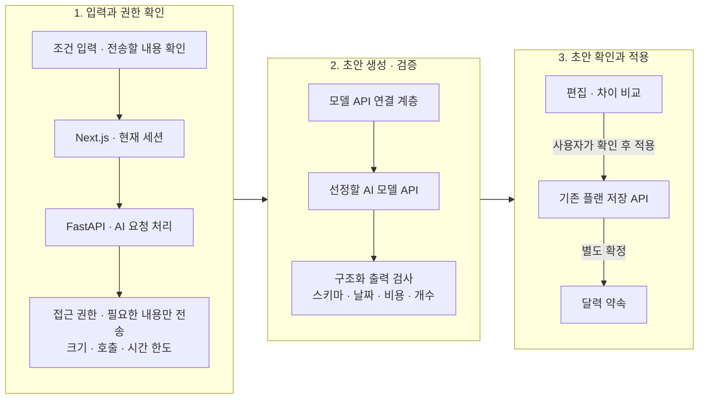

# AI 기능의 구현 방향

[README](../README.md) · [현재 아키텍처](architecture.md)

**서비스 내 대화형 AI는 아직 구현되지 않았습니다.** 외부 AI가 사용할 [일정·코스 관리 API와 작업 지침](agent-api.md)은 제공하지만 모델 호출은 하지 않습니다. 외부 ChatGPT는 요청받은 자료 조회/변경을 수행하는 작업자이며, 내장 AI는 대화로 플랜을 함께 만드는 역할로 구분합니다. Cloudflare 무료 AI는 내장 모델 공급자 후보이며 아직 연결하지 않았습니다. 이 문서는 도입을 검토할 때 사용할 설계 제안입니다. 아래 API와 구성 요소는 현재 제공하는 기능이나 설정이 아닙니다.

## 1. AI가 도울 일

처음에는 사용자가 입력한 날짜·예산·희망 활동을 바탕으로 **수정할 수 있는 데이트 플랜 초안**을 만드는 기능을 검토합니다. AI가 초안을 제안하면 사용자가 내용을 고쳐 저장하고, 기존 방식대로 상대와 함께 편집하거나 확정하는 흐름입니다.

| 후보 기능 | 입력 | 결과 | 사용자가 할 일 |
| --- | --- | --- | --- |
| 플랜 초안 | 날짜·예산·교통수단·하고 싶은 활동 | 순서 있는 활동·준비물 | 편집 후 저장/확정 |
| 초안 개선 | 사용자가 선택한 플랜 내용과 요청 | 변경 이유와 수정 후보 | 이전/새 내용 비교 후 적용 |
| 리포트 작성 보조 | 직접 선택한 메모·방문/비용 정보 | 기존 회고 템플릿의 초안 | 작성자가 수정하고 공유 |
| 지난 기록을 활용한 추천 | 사용자가 직접 선택한 지난 기록 | 다시 하고 싶은 활동 후보 | 사용할 기록과 추천 결과 선택 |

입력하지 않은 비용은 0원이 아닌 미정으로 남깁니다. 사용자가 제공하지 않은 방문·결제·추억을 실제 있었던 일처럼 작성하지 않습니다. AI가 만든 데이트 계획과 실제 만남 기록도 구분합니다.

## 2. 기존 기능과 연결하는 방법



AI API 키는 서버에만 보관하는 구조를 제안합니다. FastAPI가 모델 API를 호출하고 응답을 검사하며, 모델별 API 차이는 별도 연결 계층에서 처리합니다. 모델에는 앱 데이터베이스나 사진 저장소에 직접 접근할 권한을 주지 않습니다. 사용자가 결과를 적용한 뒤에도 기존 플랜 저장 검사를 거쳐야 하며, 달력 등록과 리포트 공유는 별도로 확인합니다.

첫 구현은 조건 입력 → 정해진 형식의 초안 생성 → 결과 검사에 집중하는 안입니다. 여러 도구를 연속해서 사용하는 AI Agent는 결과의 정확성과 서비스 이용 조건, 호출 비용을 관리할 수 있을 때 검토합니다. 첫 단계부터 벡터 DB나 작업 큐, 실시간 위치 서비스를 추가할 필요는 없습니다.

## 3. 기존 플랜 템플릿 재사용

AI의 응답은 현재 플랜 데이터 형식인 `PlanContent`에 맞춰 받는 방안입니다. 아래처럼 JSON 형식이 올바르더라도 날짜·비용·활동 내용이 실제 요청에 맞는지는 추가로 검사해야 합니다.

```json
{
  "title": "느긋한 주말 오후",
  "date": "2026-10-24",
  "budget": 60000,
  "transport": "대중교통",
  "activities": [
    {
      "title": "함께 산책",
      "time": "14:00",
      "place": "사용자가 선택한 산책길",
      "cost": null,
      "note": "구체적인 장소와 이동 시간은 직접 확인"
    }
  ],
  "preparation": ["물 한 병", "가벼운 겉옷"]
}
```

플랜 이름과 날짜, 활동 개수, 글자 수, 시간과 금액 범위를 검사하는 안입니다. 사용자가 요청한 날짜와 일치하는지, 활동 시간이 순서에 맞는지, 미정 비용과 0원을 구분했는지도 확인합니다. 확인할 수 없는 정보는 미정으로 표시합니다. 모델이 만든 상호·영업시간·좌표를 확인된 정보처럼 제공하지 않습니다.

## 4. 추가 도구를 연결할 때 확인할 점

| 도구 후보 | 허용할 역할 | 별도 확인할 조건 |
| --- | --- | --- |
| 플랜 검토 | 기존 코드의 예산·시간 검사 사용 | 참고 안내와 저장 불가 오류 구분 |
| 장소 후보 | 사용자가 제공하거나 이용 조건상 허용된 정보 조회 | 공급자의 보관·가공·AI 전달 이용 조건 |
| 이동 보조 | 명시한 목적지와 교통수단의 참고 정보 | 실제 방문/GPS·주행 기록으로 오인 방지 |
| 과거 기록 조회 | 사용자가 볼 수 있는 기록 중 선택한 것만 조회 | 상대 개인 초안 제외·공유 철회 반영 |
| 리포트 보조 | 선택 메모를 현재 템플릿으로 정리 | 제공한 내용만 사용·개인 초안으로 저장 |

도구를 호출할 때마다 서버가 사용자의 소속과 접근 권한, 입력 형식을 확인하도록 설계합니다. 검색 결과나 문서에 적힌 지시로 권한이 바뀌어서는 안 됩니다. 초기에는 모델이 임의의 URL이나 파일에 접근하거나 SQL을 실행하고, 기록을 공유·삭제하는 도구는 제공하지 않는 안입니다.

## 5. 개인정보와 비용

- 전송 전에 사용자가 선택한 플랜 텍스트/조건의 범위를 보여주고 최소한만 전달하는 흐름을 검토합니다. 사진·계정 식별자·개인 답변·정밀 좌표를 기본 입력에 포함하지 않습니다.
- 로그에는 프롬프트 원문이나 리포트 내용, API 키 대신 처리 결과·소요 시간·사용량을 남기는 방안입니다.
- 공급자 선정 시 데이터 보관·학습 사용·지역·모델 이용 조건을 확인합니다. 현재 특정 공급자의 개인정보 정책이나 무료 한도를 보장하지 않습니다.
- 요청당 입력/출력 크기·시간·재시도 수와 설치별 사용 상한을 두고, 설정한 예산을 넘으면 호출을 중단하는 구성을 검토합니다.
- 모델/네트워크 실패나 취소 후에도 직접 작성한 초안을 유지하고 수동 편집으로 이어갑니다.

공급자는 미정입니다. [Cloudflare Workers AI](https://developers.cloudflare.com/workers-ai/)를 포함한 API 제공 방식을 후보로 비교할 수 있지만, 현재 저장소에는 해당 연동이나 AI용 환경 변수가 없습니다. 모델은 요청한 응답 형식을 잘 지키는지, 한국어가 자연스러운지, 속도와 비용은 적절한지, 데이터 이용 조건을 충족하는지 비교한 뒤 선정해야 합니다.

## 6. 단계별 확장 계획

| 단계 | 구현 결과 | 다음 단계 전에 확인할 것 |
| --- | --- | --- |
| 현재 | 수동 플랜·확정·기록·회고·검색 | AI 없이도 전 과정 사용 가능 |
| 1. 제한된 초안 | 조건 → 현재 템플릿 → 검증/미리보기 | 응답 누락·형식 오류 처리, 사용량 제한, 취소·오류 복구 |
| 2. 수정 제안 | 기존 초안의 부분 수정·차이 비교 | 작성 중인 내용 유지, 동시 수정 충돌 안내, 확인 후 적용 |
| 3. 검증된 도구 | 허용한 장소/일정 정보의 제한 조회 | 도구별 이용 조건, 접근 권한, 출처, 호출 횟수 제한 |
| 4. 회고 보조 | 직접 선택한 메모의 템플릿 정리 | 제공한 사실만 사용, 개인 초안·공유 취소, 로그에서 원문 제외 |
| 5. 선택한 지난 기록 활용 | 사용자가 선택한 기록으로 맞춤 추천 | 기록 사용 동의와 삭제, 다른 공간의 접근 차단, 추천 품질 평가 |

기능을 확장하더라도 최종 확정은 사용자가 직접 하는 흐름을 유지하는 안입니다. 모델이 응답했는지만 보지 않고 실제로 도움이 되는 플랜인지 평가해야 합니다. 모델 선정과 구현, 검증을 마친 뒤에만 제공 중인 기능으로 안내합니다.
