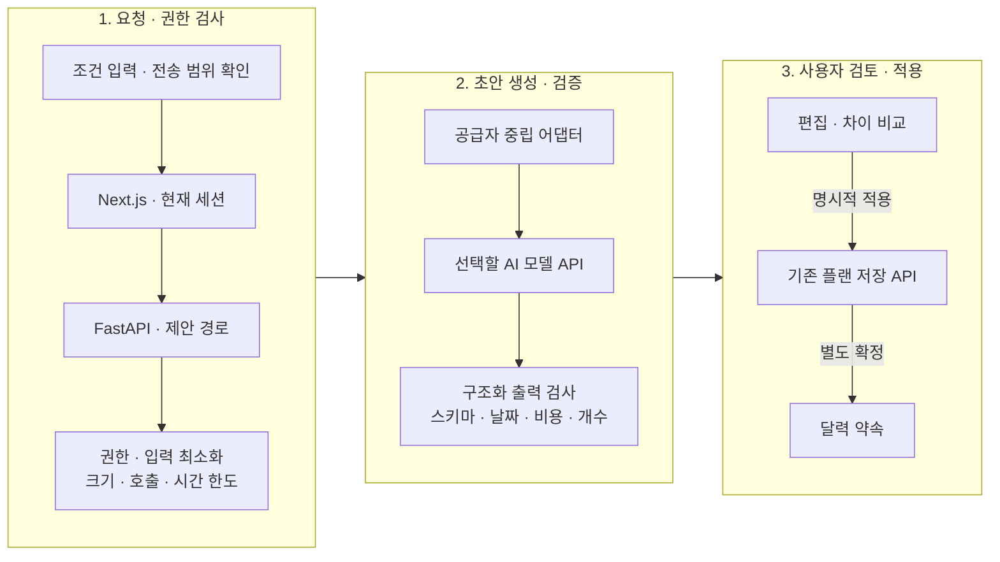

# AI 기능의 구현 방향

[README](../README.md) · [현재 아키텍처](architecture.md)

**이 문서는 향후 설계 제안입니다. 현재 앱에는 AI 호출·플랜 자동 생성·AI 학습/검색 인덱스가 구현되어 있지 않습니다.** 아래 API·구성 요소도 앞으로 추가할 후보이며 지금 실행할 수 있는 설정이 아닙니다.

## 1. AI가 도울 일

첫 목표는 대화만 가능한 챗봇보다, 사용자가 적은 조건을 **편집 가능한 데이트 플랜 템플릿**으로 정리하는 것입니다. 지금 제공하는 직접 작성·공동 편집·확정 흐름을 그대로 사용하고 AI는 그 앞에서 초안을 제안합니다.

| 후보 기능 | 입력 | 결과 | 사람의 최종 선택 |
| --- | --- | --- | --- |
| 플랜 초안 | 날짜·예산·교통수단·하고 싶은 활동 | 순서 있는 활동·준비물 | 편집 후 저장/확정 |
| 초안 개선 | 사용자가 선택한 플랜 내용과 요청 | 변경 이유와 수정 후보 | 이전/새 내용 비교 후 적용 |
| 리포트 작성 보조 | 직접 선택한 메모·방문/비용 정보 | 기존 회고 템플릿의 초안 | 작성자가 수정하고 공유 |
| 기억 기반 추천 | 향후 별도 선택한 과거 기록 | 다시 하고 싶은 활동 후보 | 기록의 사용 범위와 후보 채택 |

미입력 비용을 0원으로 채우거나, 사용자가 말하지 않은 방문·결제·기억을 사실로 만들지 않습니다. 생성된 일정과 실제 만남 기록은 계속 분리합니다.

## 2. 기존 시스템에 붙이는 방식



AI 키는 서버에만 둡니다. 공급자가 앱 DB나 Storage를 직접 조회하거나 SQL을 실행하게 하지 않습니다. 모델 응답은 기존 플랜 저장 경로에서 다시 검증하며, 생성 성공만으로 달력에 확정하거나 사진/리포트를 공유하지 않습니다.

최초 구현은 제한된 입력 → 구조화 초안 → 검증의 짧은 흐름을 우선 검토합니다. 여러 도구를 스스로 반복 실행하는 Agent는 정확성·이용 조건·비용 상한을 통제할 수 있는 단계에서 확장합니다. 별도 벡터 DB·작업 큐·실시간 위치 서비스는 초기 AI 초안의 필수 구성으로 두지 않습니다.

## 3. 기존 플랜 템플릿 재사용

현재 직접 작성하는 `PlanContent`에 맞춰 아래와 같은 결과를 받는 방안입니다. JSON 생성 자체와 유효한 업무 계획은 구분합니다.

```json
{
  "title": "느긋한 주말 오후",
  "date": "2026-10-24",
  "budget": 60000,
  "transport": "대중교통",
  "activities": [
    {
      "title": "함께 산책",
      "time": "14:00",
      "place": "사용자가 선택한 산책길",
      "cost": null,
      "note": "구체적인 장소와 이동 시간은 직접 확인"
    }
  ],
  "preparation": ["물 한 병", "가벼운 겉옷"]
}
```

검증 후보는 필수 이름/날짜, 활동 수와 문자열 길이, 허용한 시간/금액 범위, 예산 미정과 0원 구분, 활동 순서의 시각 역전, 사용자 날짜와 결과 날짜 일치입니다. 알 수 없는 값은 미정으로 두고 어떤 정보가 확인되지 않았는지 표시합니다. 모델이 만들어 낸 상호·영업시간·좌표를 검증된 장소처럼 사용하지 않습니다.

## 4. 도구를 붙일 때의 경계

| 도구 후보 | 허용할 역할 | 별도 확인할 조건 |
| --- | --- | --- |
| 플랜 검토 | 기존 예산/시각 점검의 결정적인 규칙 재사용 | 비차단 안내와 저장 오류 구분 |
| 장소 후보 | 사용자가 제공하거나 조건상 사용할 수 있는 정보만 조회 | 공급자의 보관·가공·AI 전달 이용 조건 |
| 이동 보조 | 명시한 목적지와 교통수단의 참고 정보 | 실제 방문/GPS·주행 기록으로 오인 방지 |
| 과거 기록 조회 | 본인이 선택한 권한 범위에서 읽기 | 상대 개인 초안 제외·공유 철회 반영 |
| 리포트 보조 | 선택 메모를 현재 템플릿으로 정리 | 사실 추가 금지·개인 초안 유지 |

도구 호출마다 서버가 사용자의 현재 소속/권한과 인자 스키마를 검증합니다. 문서·검색 결과·리포트에 적힌 지시를 시스템 권한으로 취급하지 않습니다. 모델에게 임의 URL 요청·파일 접근·SQL·공유/삭제 도구를 제공하는 방안은 초기 범위에 포함하지 않습니다.

## 5. 개인정보와 비용

- 전송 전에 사용자가 선택한 플랜 텍스트/조건의 범위를 보여주고 최소한만 전달하는 흐름을 검토합니다. 사진·계정 식별자·개인 답변·정밀 좌표를 기본 입력에 포함하지 않습니다.
- 시스템 로그에는 원문 프롬프트·리포트·키를 쌓지 않고 요청 상태·처리 시간·사용량 같은 운영 메타데이터 중심으로 관찰합니다.
- 공급자 선정 시 데이터 보관·학습 사용·지역·모델 이용 조건을 확인합니다. 현재 특정 공급자의 개인정보 정책이나 무료 한도를 보장하지 않습니다.
- 요청당 입력/출력 크기·시간·재시도 수와 설치별 사용 상한을 두고, 설정한 예산을 넘으면 호출을 중단하는 구성을 검토합니다.
- 모델/네트워크 실패나 취소 후에도 직접 작성한 초안을 유지하고 수동 편집으로 이어갑니다.

공급자는 미정입니다. [Cloudflare Workers AI](https://developers.cloudflare.com/workers-ai/)를 포함한 API 제공 방식을 후보로 비교할 수 있지만, 현재 저장소에는 해당 연동이나 AI용 환경 변수가 없습니다. 모델은 구조화 출력의 신뢰성·한국어 품질·지연·비용·데이터 조건을 같은 기준으로 평가한 뒤 정합니다.

## 6. 고도화 순서와 완료 기준

| 단계 | 구현 결과 | 다음 단계 전에 확인할 것 |
| --- | --- | --- |
| 현재 | 수동 플랜·확정·기록·회고·검색 | AI 없이도 전 과정 사용 가능 |
| 1. 제한된 초안 | 조건 → 현재 템플릿 → 검증/미리보기 | 정상/미정/불완전 JSON·한도·취소·오류 복구 |
| 2. 수정 제안 | 기존 초안의 부분 수정·차이 비교 | 입력 보존·동시 편집 충돌·명시적 적용 |
| 3. 검증된 도구 | 허용한 장소/일정 정보의 제한 조회 | 도구별 이용 조건·권한·출처·호출 상한 |
| 4. 회고 보조 | 직접 선택한 메모의 템플릿 정리 | 사실성·개인 초안/공유 철회·원문 비출력 |
| 5. 선택형 기억 활용 | 권한 범위의 기록으로 개인화 | 동의/삭제·공간 간 격리·검색 품질·재현 가능한 평가 |

고도화 과정에서도 사용자가 직접 확정하는 구조를 유지합니다. 공급자가 응답했다는 사실과 유용하고 실행 가능한 데이트 플랜이 생성됐다는 사실은 각각 평가해야 합니다. AI 기능의 도입은 실제 모델 선정·구현·검증 이후 제공 상태에 반영합니다.
