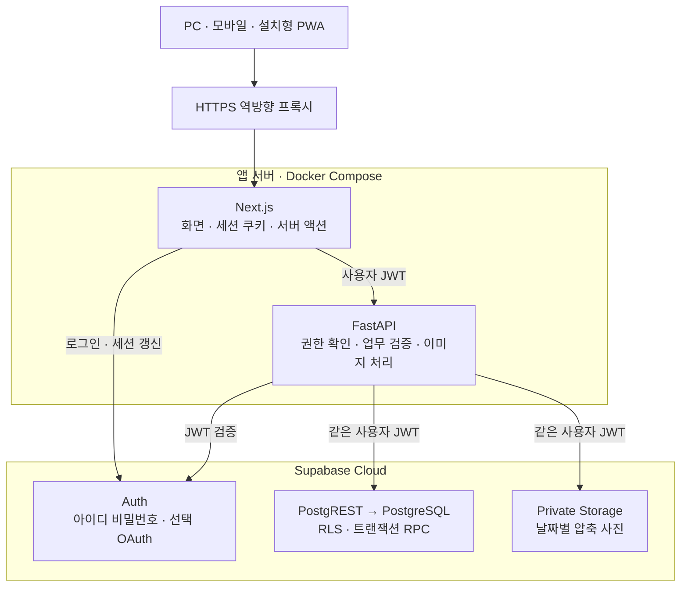
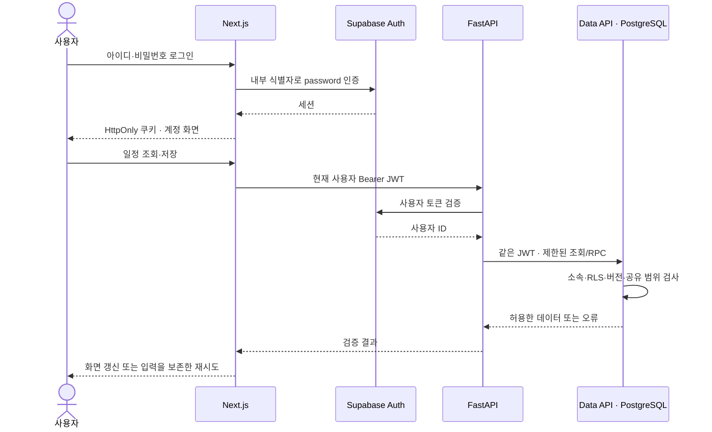
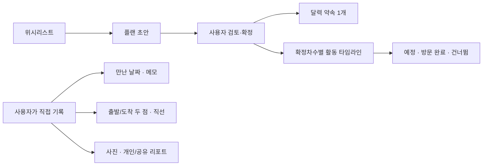
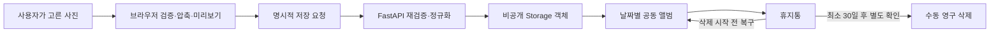
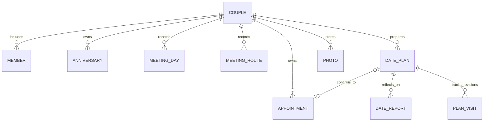
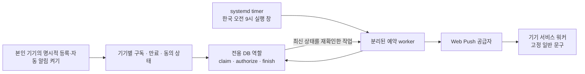

# 시스템 아키텍처

[README](../README.md) · [설치](setup.md) · [배포](deployment.md) · [AI 설계 방향](ai-roadmap.md)

이 문서는 현재 소스의 실행 구조를 설명합니다. AI는 [별도 로드맵](ai-roadmap.md)의 제안이며 현재 실행 경로에 포함되지 않습니다.

## 1. 실행 단위와 책임

| 실행 단위 | 책임 | 보관하지 않는 것 |
| --- | --- | --- |
| 브라우저 | 달력 조작, 입력, 사진 압축, 사용자가 선택한 지도 표시 | DB 관리자 키, Push 개인키 |
| Next.js | 서버 렌더링, 인증 콜백/쿠키, 서버 액션, 인증된 사진 중계 | 업무용 관리자 DB 자격 |
| FastAPI | 인증 재확인, 입력 검증, 업무 API, 이미지 재검증/정규화 | 사용자의 비밀번호 DB |
| Supabase Auth | 비밀번호 검증, OAuth 연동, 세션 발급 | 앱 자체 인증 구현으로 대체하지 않음 |
| PostgreSQL | 커플 소속, 일정/기록, RLS, 충돌·재시도·공유 규칙 | 사진 원본 바이트 |
| Private Storage | 압축 사진 객체와 접근 제어 | 서버의 상시 원본 사진 보관 |
| 선택형 예약 worker | 제한된 알림 함수 실행과 Web Push 전달 | 일반 업무 테이블 직접 조회 권한 |

웹과 업무 API는 하나의 저장소에 있지만 독립 프로세스입니다. 로컬에서는 웹 `3000`, API `8000`을 loopback에 바인딩합니다. 운영용 독립 Compose는 웹을 `127.0.0.1:3200`에 두고 API 호스트 포트를 열지 않습니다. DB/Auth/Storage는 앱 컨테이너와 별도의 Supabase 프로젝트입니다.

## 2. 로그인과 요청의 권한 경계

- 아이디는 서버에서 `아이디@login.we2day.invalid` 식별자로 변환합니다. 실제 이메일 입력·수신 인증·공개 회원가입 화면은 없습니다.
- Google/Kakao를 사용하면 공급자 로그인 → Supabase callback → 앱 `/auth/callback` 순서로 세션을 만듭니다. 공급자 Client Secret은 Supabase에 설정합니다.
- 인증 쿠키는 HttpOnly·SameSite=Lax이며 HTTPS에서는 Secure입니다. 테마 쿠키와 인증 쿠키는 별개입니다.
- 커플 공간은 초대 기반이며 두 계정이 연결됩니다. 로그인 성공만으로 다른 공간의 기록을 볼 수 없습니다.
- 개인 리포트/답변은 작성자가 명시적으로 공유하기 전까지 비공개입니다. 상대의 비공개 원문은 공동 화면·검색·사본 내보내기에 포함하지 않습니다.

## 3. 플랜과 실제 만남은 별개

초안은 달력에 나타나지 않고 확정할 때 약속 하나와 연결됩니다. 확정 뒤 초안을 수정하면 기존 달력은 유지하며, 다시 확정할 때 연결 약속을 갱신합니다. 활동이 달라진 새 확정안은 새 진행 기록을 시작하고 이전 확정안의 방문 진행을 보존합니다.

지도 열기·시간 경과·플랜 확정은 실제 만남이나 방문 완료를 자동 생성하지 않습니다. 동선은 날짜별 출발점/도착점의 **직선 연결**입니다. 주행 GPS·실제 도로 경로·이동 거리의 증명으로 사용하지 않습니다.

## 4. 사진과 기록의 수명주기

사진에는 올린 사람·업로드 시각·날짜·한마디와 제공 가능한 원래 파일 참조 정보를 연결합니다. 실제 원본 사진은 각자의 휴대폰에서 찾을 수 있도록 돕고 서버에는 압축본을 저장합니다. 휴지통은 일반 앨범/사진 URL에서 제외하며, 30일이 지나도 자동 영구 삭제하지 않습니다.

사진 ZIP과 기록 JSON은 사용자가 선택한 범위의 사본입니다. JSON 체크섬은 우발적 손상을 검사하며 서명/진위를 인증하지 않습니다. DB·Auth·Storage 전체 복원이나 사진 누락 검증을 대신하지 않습니다.

## 5. 데이터의 주요 연결

개념 관계를 간추린 그림이며 물리 테이블/컬럼 전체는 [SQL 마이그레이션](../supabase/migrations/)이 원본입니다. 이 밖에 공동 목록·목표·질문/개인 답변·시간대 설정·룰렛/뽑기 기록과 기기별 알림 구독을 저장합니다. 자료의 소속·작성자·공유 상태·버전은 화면과 서버/SQL에서 함께 다룹니다.

### 저장 충돌과 재시도

업무 쓰기는 사용자 소속과 입력을 확인하고 SQL 트랜잭션에서 처리합니다. 화면에서 읽은 버전과 최신 버전이 다르면 덮어쓰지 않고 충돌을 반환합니다. 사용자가 입력을 확인한 뒤 최신본을 명시적으로 불러오게 합니다. 요청 식별자로 응답 손실 뒤 같은 요청을 재시도할 때의 중복 생성을 제어합니다.

## 6. 선택형 지도·검색·앱 이동

| 기능 | 호출 주체 | 범위 |
| --- | --- | --- |
| 장소 검색 | FastAPI → NAVER API HUB | 사용자가 검색한 결과의 일시 열람 |
| 지도 표시 | 브라우저 → NAVER Maps SDK | 사용자가 펼친 지도 프레임·직접 지정한 두 점 |
| 네이버 지도 앱 이동 | 사용자의 링크 클릭 | 선택 장소 검색/목적지 길안내 요청 |

검색 키와 Maps 브라우저 Client ID는 다른 설정입니다. 검색 결과를 자동으로 장기 저장하거나 AI에 전달하지 않습니다. 공급자 결과의 보관·가공·AI 사용은 이용 조건을 확인해야 합니다. 지도 앱에서 돌아온 사실만으로 방문 완료를 기록하지 않습니다.

## 7. 선택형 기념일 자동 알림

worker는 API/웹과 다른 환경 파일에서 자격을 읽습니다. TLS 인증서/호스트를 검증하고 전용 함수만 실행하며 일반 업무 테이블에 직접 접근하지 않습니다. 슬롯·lease·기념일 버전·소속·기기 해지/만료를 재확인합니다.

기본 시점은 한국 시간 오전 9시, 기념일 7일 전·1일 전·당일입니다. 해당 아침 실행 창 안에서만 시도하며 이전 시점을 몰아서 보내지 않습니다. 실제 도착은 기기/공급자/네트워크에 따라 달라집니다. 잠금화면에는 이름·장소·사진을 넣지 않습니다. 서버 설정과 본인 기기의 자동 알림 동의를 모두 갖춰야 합니다.

## 8. 성능과 PWA의 현재 범위

Next Link의 클라이언트 전환과 공통 탐색을 유지합니다. 독립 조회를 병렬 실행하고 요청 수명 안에서 인증 클라이언트를 재사용합니다. FastAPI는 연결 풀을 재사용하면서 사용자 헤더/쿠키는 요청별로 분리합니다. 사용자 기록과 인증 응답은 `private, no-store` 경계를 유지합니다.

PWA는 홈 화면 실행·설치 안내·오프라인 연결 안내·기기 알림을 제공합니다. 일정/사진/리포트의 오프라인 열람·편집과 네이티브 OS 위젯은 현재 제공하지 않습니다. 모든 페이지·사진을 한 번에 미리 가져오거나, 공개 캐시에 개인 기록을 저장하는 구성은 사용하지 않습니다.

## 9. 코드 위치

| 경로 | 책임 |
| --- | --- |
| [`apps/web/src/app`](../apps/web/src/app/) | 화면, 서버 액션, Route Handler, 인증 콜백 |
| [`apps/web/src/components`](../apps/web/src/components/) | 달력·사진·플랜·기록·공동 활동 UI |
| [`apps/web/src/lib`](../apps/web/src/lib/) | 타입·서버 API·날짜/입력·지도·파일 helper |
| [`apps/api/src/we2day_api`](../apps/api/src/we2day_api/) | FastAPI와 오프라인 운영 도구 |
| [`supabase/migrations`](../supabase/migrations/) | DB 구조, RLS, 업무 RPC, Storage/알림 계약 |
| [`apps/api/deployment`](../apps/api/deployment/) | 전용 Compose·프록시·예약 서비스 예시 |

전체 API 경로는 실행 중인 FastAPI의 `/docs`에서 확인할 수 있습니다. 내부 API는 운영 환경에서 인터넷에 직접 노출하지 않고 웹 서버를 통해 사용합니다.
