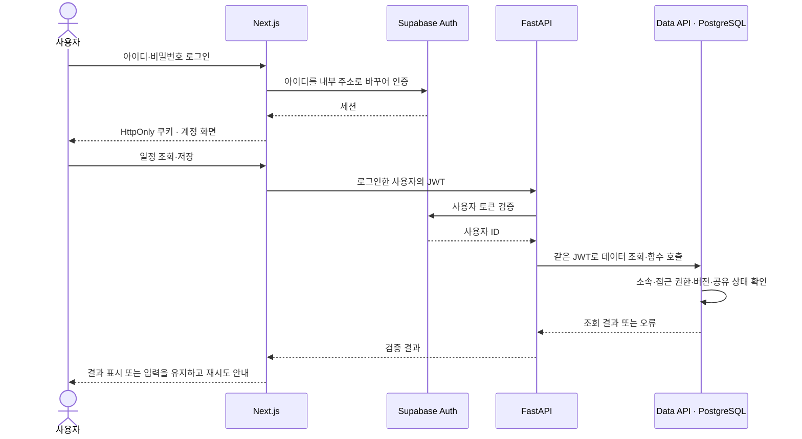
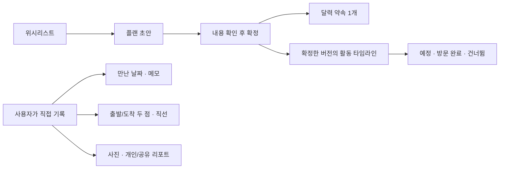
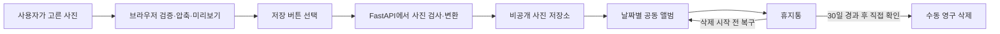
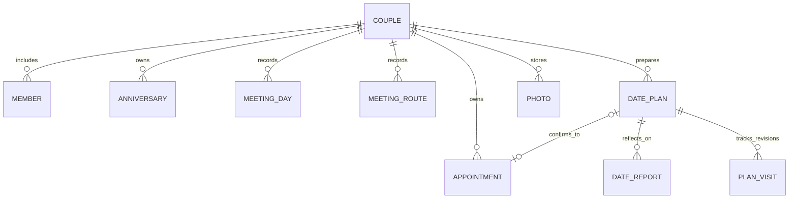
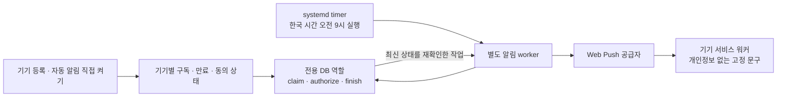

# 시스템 아키텍처

[README](../README.md) · [설치](setup.md) · [배포](deployment.md) · [AI 설계 방향](ai-roadmap.md)

이 문서는 현재 구현된 시스템이 어떻게 동작하는지 설명합니다. AI는 아직 구현되지 않았으며, 도입 방향은 [AI 로드맵](ai-roadmap.md)에 따로 정리했습니다.

## 1. 전체 구성

| 구성 요소 | 역할 | 접근 권한·저장 범위 |
| --- | --- | --- |
| 브라우저 | 달력과 입력 화면, 사진 압축, 지도 표시 | 로그인한 사용자의 화면과 입력 처리 |
| Next.js | 화면 렌더링, 로그인과 세션 관리, API 호출, 사진 응답 중계 | 현재 사용자의 인증 토큰으로 요청 |
| FastAPI | 인증·입력 확인, 일정과 기록 처리, 업로드한 사진 검사 | 관리자 키 대신 현재 사용자의 권한 사용 |
| Supabase Auth | 아이디·비밀번호와 소셜 로그인, 세션 발급 | 계정과 비밀번호 인증 관리 |
| PostgreSQL | 공간과 멤버, 일정·기록 저장, 접근 제어와 동시 수정 처리 | 같은 공간의 공유 자료와 본인의 비공개 자료 |
| Private Storage | 날짜별 사진 파일 저장 | 원본 대신 압축본을 비공개로 보관 |
| 예약 작업(worker, 선택) | 기념일 알림 확인과 발송 | 전용 DB 함수만 실행, 일반 테이블 직접 접근 불가 |

Next.js와 FastAPI는 같은 저장소에서 관리하지만 각각 별도 프로세스로 실행됩니다. 로컬에서는 웹 `3000`, API `8000` 포트에 같은 PC에서만 접속할 수 있습니다. 운영용 Compose는 웹을 `127.0.0.1:3200`에 연결하고, API는 컨테이너 내부 네트워크에서만 접근하도록 구성합니다. 외부 접속은 HTTPS 프록시를 거칩니다. 데이터베이스·인증·사진 저장소는 별도의 Supabase 프로젝트를 사용합니다.

## 2. 로그인과 접근 권한

- 로그인할 때 서버가 아이디를 `아이디@login.we2day.invalid` 형태의 내부 주소로 변환합니다. 실제 이메일 입력·수신 인증·공개 회원가입 화면은 없습니다.
- Google/Kakao를 사용하면 해당 서비스의 로그인 화면 → Supabase → 앱의 `/auth/callback` 순서로 돌아와 세션을 만듭니다. Google/Kakao의 Client Secret은 Supabase에만 설정합니다.
- 인증 쿠키는 HttpOnly·SameSite=Lax이며 HTTPS에서는 Secure입니다. 화면 테마를 저장하는 쿠키와 로그인 쿠키는 따로 관리합니다.
- 커플 공간은 초대 기반이며 두 계정이 연결됩니다. 로그인 성공만으로 다른 공간의 기록을 볼 수 없습니다.
- 개인 리포트(데이트 후기)와 답변은 작성자가 공유하기 전까지 상대방에게 보이지 않습니다. 검색과 기록 다운로드에서도 상대의 비공개 내용은 제외됩니다.

## 3. 데이트 계획과 실제 만남 기록

플랜 초안은 달력에 표시되지 않습니다. 내용을 확정하면 달력 약속 하나와 연결됩니다. 이후 초안을 수정해도 기존 약속은 그대로 유지되며, 다시 확정할 때 약속에 변경 내용이 반영됩니다. 새로 확정한 플랜은 별도의 방문 진행 기록을 사용합니다. 이전 버전의 방문 기록도 남아 있습니다.

지도 열기·시간 경과·플랜 확정은 실제 만남이나 방문 완료를 자동 생성하지 않습니다. 동선은 날짜별 출발점/도착점의 **직선 연결**입니다. GPS로 수집한 이동 경로나 실제 도로를 따라간 기록은 아닙니다.

## 4. 사진 저장과 삭제

브라우저는 사진을 최대 1600px·1MiB로 줄입니다. WebP 인코딩이 지원되지 않으면 JPEG로 압축하고, FastAPI가 파일 형식과 크기를 검사한 뒤 메타데이터 없는 WebP로 변환합니다. 원본 파일은 전송하지 않으며 Storage 경로·이미지 조회·ZIP 내보내기 형식은 WebP로 유지합니다. 로컬 압축본 다운로드는 실제 형식에 따라 `.jpg` 또는 `.webp`를 사용합니다.

사진과 함께 올린 사람, 업로드 시각, 만난 날짜, 한마디와 확인 가능한 원본 파일 정보를 저장합니다. 원본 파일 정보는 각자의 휴대폰에서 사진을 찾을 때 참고할 수 있습니다. 서버에는 압축본만 보관합니다. 휴지통으로 옮긴 사진은 일반 앨범과 사진 조회에서 제외되며, 30일이 지나도 자동으로 영구 삭제되지 않습니다. 영구 삭제를 시작하기 전까지 복구할 수 있습니다.

사진 ZIP과 기록 JSON에는 사용자가 선택한 자료만 담깁니다. JSON의 체크섬은 파일이 손상됐는지 확인하는 용도이며, 작성자나 내용의 진위를 증명하지는 않습니다. 이 파일들은 데이터베이스·계정·사진 전체를 복원하기 위한 백업과 다릅니다.

## 5. 주요 데이터 관계

이 그림은 주요 데이터의 관계를 간추린 것입니다. 실제 테이블과 컬럼은 [SQL 마이그레이션](../supabase/migrations/)이 원본입니다. 이 밖에 공동 목록·목표·질문/개인 답변·시간대 설정·룰렛/뽑기 기록과 기기별 알림 구독을 저장합니다. 화면과 서버, 데이터베이스는 각 자료가 속한 공간과 작성자, 공유 상태, 버전을 확인합니다.

### 동시에 수정하거나 저장을 다시 시도할 때

일정이나 플랜을 저장할 때는 사용자의 소속과 입력을 확인한 뒤 데이터베이스 트랜잭션으로 처리합니다. 다른 사람이 먼저 수정해 버전이 달라졌다면 자동으로 덮어쓰지 않습니다. 작성 중인 내용을 유지한 채 최신 내용을 확인하도록 안내합니다. 저장 응답을 받지 못해 같은 요청을 다시 보내더라도 중복으로 생성되지 않도록 요청 ID를 함께 사용합니다.

## 6. 장소 검색과 지도 연동

| 기능 | 호출 주체 | 범위 |
| --- | --- | --- |
| 장소 검색 | FastAPI → NAVER API HUB | 검색 결과 표시 |
| 지도 표시 | 브라우저 → NAVER Maps SDK | 사용자가 연 지도와 직접 지정한 두 점 표시 |
| 네이버 지도 앱 이동 | 사용자의 링크 클릭 | 선택한 장소 검색 또는 길안내 |

장소 검색용 키와 지도 표시용 Client ID는 각각 설정해야 합니다. 검색 결과를 자동으로 장기 저장하거나 AI에 전달하지 않습니다. 공급자 결과의 보관·가공·AI 사용은 이용 조건을 확인해야 합니다. 지도 앱에서 돌아온 사실만으로 방문 완료를 기록하지 않습니다.

## 7. 기념일 자동 알림

알림 worker는 웹·API와 별도의 환경 파일에서 접속 정보를 읽습니다. 연결할 때 TLS 인증서와 호스트 이름을 확인하고, 일반 테이블 대신 전용 DB 함수만 호출합니다. 같은 알림을 중복으로 보내지 않도록 발송 상태를 관리하며, 보내기 직전에 기념일 수정 여부와 사용자의 소속, 기기 등록·만료 상태를 다시 확인합니다.

기본 시점은 한국 시간 오전 9시, 기념일 7일 전·1일 전·당일입니다. 발송은 당일 오전 9~10시 사이에만 시도하며, 놓친 알림을 나중에 몰아서 보내지는 않습니다. 실제 도착은 기기/공급자/네트워크에 따라 달라집니다. 잠금화면에는 이름·장소·사진을 넣지 않습니다. 서버 설정을 마친 뒤 알림을 받을 기기에서도 자동 알림을 직접 켜야 합니다.

## 8. 페이지 이동과 PWA 지원 범위

페이지를 이동할 때는 Next.js Link를 사용해 필요한 화면을 불러옵니다. 서로 의존하지 않는 데이터는 병렬로 조회하고, 같은 요청 안에서는 인증 클라이언트를 재사용합니다. FastAPI도 연결 풀을 재사용하지만 사용자별 헤더와 쿠키는 요청마다 분리합니다. 개인 기록과 인증 응답에는 `private, no-store`를 적용해 공유 캐시에 남지 않도록 합니다.

PWA는 홈 화면에서 실행하기, 설치 방법 안내, 연결이 끊겼을 때의 안내 화면, 기기 알림을 지원합니다. 일정/사진/리포트의 오프라인 열람·편집과 네이티브 OS 위젯은 현재 제공하지 않습니다. 모든 페이지·사진을 한 번에 미리 가져오거나, 공개 캐시에 개인 기록을 저장하는 구성은 사용하지 않습니다.

## 9. 백업 실행 구조

운영 백업은 웹·API·알림과 분리된 일회성 컨테이너에서 실행합니다. 별도 서버 자격으로 DB를 읽고 사진 파일을 수집해 암호화한 뒤 종료하며, systemd timer가 매일 실행을 요청합니다. 프로젝트·키 확인과 파일 잠금으로 다른 설정의 혼입과 중복 실행을 막습니다.

변경되지 않은 사진은 무결성을 확인한 이전 백업에서 재사용합니다. 새 백업에는 전체 DB 덤프와 사진을 담으므로 이전 사본에 의존하지 않고 복구할 수 있습니다. 사본 자동 삭제와 Auth·Storage를 포함한 전체 서비스 자동 복원은 제공하지 않습니다. 설정과 복구 검토 절차는 [배포 가이드](deployment.md#daily-backup)에 있습니다.

## 10. 화면 전환과 로딩

화면 이동은 Next.js의 클라이언트 전환을 사용합니다. 다음 화면이 준비될 때까지 현재 화면을 유지하고, 링크를 누르면 상단 진행 막대를 표시합니다. 페이지 전체를 임시 로딩 문구나 다른 높이의 스켈레톤으로 바꾸지 않습니다.

달력·사진·검색 등의 조회는 기존 내용을 유지한 채 해당 영역에 음영과 로딩 아이콘을 겹쳐 표시합니다. 동선 입력과 기기 알림 설정은 처음부터 구조를 배치해 응답 전후의 높이 변화를 줄입니다. 처리 중인 영역은 잠시 조작을 막고, 버튼 이름은 유지해 폭이 바뀌지 않게 합니다. 로딩 상태는 보조 기술에도 전달하며, 동작 줄이기 설정에서는 회전과 이동 애니메이션을 멈춥니다. 조회 결과의 개수나 오류 안내에 따른 내용 변화는 실제 응답이 도착한 뒤 반영합니다.

## 11. 코드 위치

사용자 이름은 Auth 로그인 정보와 별도의 `user_profiles`에 저장합니다. 본인과 연결된 상대방만 이름을 조회할 수 있고, 수정 함수는 인증된 본인 행에만 동작합니다. 버전 비교로 다른 창의 변경을 덮어쓰지 않으며, 같은 요청의 재시도는 중복 저장하지 않습니다. 표시 이름을 권한 판정이나 로그인 식별자로 사용하지 않습니다.

| 경로 | 담당 기능 |
| --- | --- |
| [`apps/web/src/app`](../apps/web/src/app/) | 화면, 서버 액션, Route Handler, 인증 콜백 |
| [`apps/web/src/components`](../apps/web/src/components/) | 달력·사진·플랜·기록·공동 활동 UI |
| [`apps/web/src/lib`](../apps/web/src/lib/) | 타입 정의, 서버 API 호출, 날짜·입력·지도·파일 처리 도구 |
| [`apps/api/src/we2day_api`](../apps/api/src/we2day_api/) | FastAPI와 로컬에서 실행하는 운영 도구 |
| [`supabase/migrations`](../supabase/migrations/) | DB 구조, 접근 제어(RLS), 저장 함수(RPC), 사진 저장·알림 설정 |
| [`apps/api/deployment`](../apps/api/deployment/) | 전용 Compose·프록시·예약 서비스 예시 |

전체 API 경로는 실행 중인 FastAPI의 `/docs`에서 확인할 수 있습니다. 내부 API는 운영 환경에서 인터넷에 직접 노출하지 않고 웹 서버를 통해 사용합니다.
