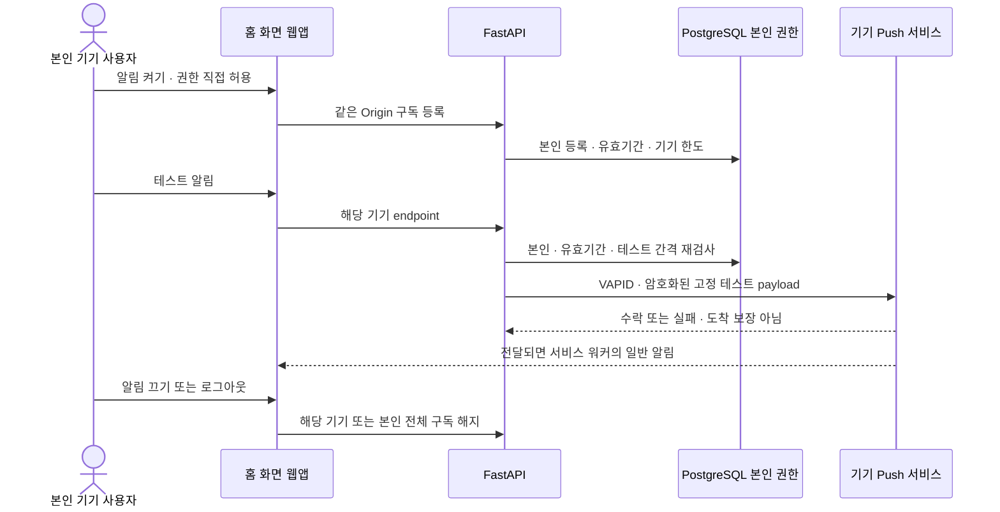
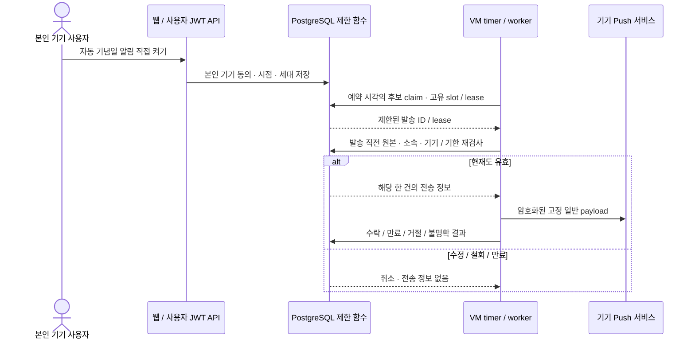

# 배포와 운영

[README](../README.md) · [설치](setup.md) · [아키텍처](architecture.md)

이 가이드는 자신의 서버에 WE2DAY를 설치하는 절차입니다. 먼저 [초기 설정](setup.md)을 마친 뒤 HTTPS 주소 준비 → 이미지 빌드·전송 → 서버 설정 → 실행 → 휴대폰 확인 순서로 진행하세요. 기본 구성은 웹과 API 컨테이너 두 개이며, 기념일 자동 알림을 사용하려면 별도 예약 작업(worker)을 추가합니다. 데이터베이스와 사진 전체의 백업·복원은 별도로 준비해야 합니다.

## 배포 전 설정 확인

저장소 루트에서 다음 명령으로 현재 개발용 환경 파일을 확인합니다.

```sh
uv run --project apps/api python -m we2day_api.preflight --compose
```

이 검사는 외부 서버에 접속하지 않고 환경 파일만 확인합니다. 웹과 API가 같은 Supabase 프로젝트를 사용하는지, 키 형식이 맞는지, 관리자 키가 섞여 있지 않은지 확인합니다. 로그인 방식, 사이트 주소와 CORS, 내부 API 주소, 검색·지도 설정도 검사합니다. 설정 값이나 키는 결과에 출력하지 않습니다.

환경 파일은 한 줄에 `KEY=VALUE` 형식으로 작성하며 값 양쪽에 따옴표를 쓸 수 있습니다. 중복 키, 변수 치환, 여러 줄 값은 지원하지 않습니다. 셸 환경 변수나 추가 Compose 설정은 자동으로 반영하지 않습니다. 실제 키의 유효성, SQL 적용 상태, OAuth 콘솔 설정, 인증서와 알림 수신은 별도로 확인해야 합니다.

운영 환경 파일을 검사하려면 `--web-env <경로> --api-env <경로> --production`을 사용합니다. HTTPS 주소와 허용한 CORS 주소가 일치하는지 확인할 수 있습니다. 로컬 Compose에서는 `environment` 설정이 `env_file`보다 우선하므로 `.env`를 바꾼 것만으로 운영 주소가 적용되지는 않습니다. [Docker 환경 우선순위](https://docs.docker.com/compose/how-tos/environment-variables/envvars-precedence/)를 따릅니다.

별도 운영 서버에서 Docker와 같은 서버의 HTTPS 프록시를 선택할 경우 사용할 수 있는 [Compose 예시](../apps/api/deployment/compose.production.example.yaml)를 제공합니다. 예시는 API 호스트 포트를 제거하고 웹을 `127.0.0.1:3000`에 유지합니다. 실제 HTTPS 사이트 주소와 같은 주소만 포함한 JSON CORS 목록을 각각 `WE2DAY_PRODUCTION_SITE_URL`, `WE2DAY_PRODUCTION_CORS_ORIGINS`로 지정해야 합니다. 프록시의 인증서와 Host 헤더 전달, OAuth·Maps 허용 주소, 백업·복원도 따로 설정해야 합니다.

```sh
# Required values must already be set; this validates only and starts no services.
docker compose -f compose.yaml -f apps/api/deployment/compose.production.example.yaml config --quiet
```

전체 백업은 [Supabase 공식 안내](https://supabase.com/docs/guides/platform/backups)에 따라 데이터베이스와 사진 파일을 각각 보관하고 복원할 수 있어야 합니다. 앱에서 받는 기록 JSON과 사진 ZIP은 선택한 자료만 포함하므로 전체 백업을 대신하지 않습니다. 아래 암호화 도구도 이미 준비한 파일 하나를 보호하는 기능이며, DB와 사진을 자동으로 수집하거나 복구하지는 않습니다.

## VM에 배포

[VM용 Compose](../apps/api/deployment/compose.vm.yaml)는 개발용 Compose와 합치지 않고 단독으로 사용합니다. 빌드는 여유 있는 PC나 빌드 서버에서 마친 뒤 웹·API 이미지를 VM으로 옮깁니다. 이 구성은 VM에서 다시 빌드하거나 이미지를 자동 다운로드하지 않습니다. 웹은 기본 `127.0.0.1:3200`, API는 Docker 내부 네트워크에서만 접근할 수 있습니다. 기존 서버의 다른 서비스와 포트는 그대로 유지하세요.

### 이미지 빌드와 전송 예시

운영 Compose는 `env_file.format: raw`를 사용하므로 [Docker Compose 2.30.0 이상](https://docs.docker.com/reference/compose-file/services/#format)이 필요합니다.

다음은 Linux `amd64` VM용 예시입니다. `arm64` VM이면 두 빌드의 platform을 모두 `linux/arm64`로 바꿉니다. 빌드 머신에는 [Docker Buildx](https://docs.docker.com/reference/cli/docker/buildx/build/)가 필요하며 저장소 루트에서 실행합니다. `release`는 예시 태그이므로 실제 배포에는 버전별 고유 태그를 권장합니다. Dockerfile은 런타임에 환경 파일을 읽으며 실제 키를 빌드 인자로 전달하지 않습니다.

```sh
docker buildx build --platform linux/amd64 --load -f apps/api/Dockerfile -t we2day-api:release .
docker buildx build --platform linux/amd64 --load -f apps/web/Dockerfile -t we2day-web:release .
docker image save --output images.tar we2day-api:release we2day-web:release
```

본인 SSH 설정의 `my-vm`과 전용 경로를 실제 값으로 교체합니다. 아래 원격 명령은 아직 없는 전용 디렉터리를 만드는 예시입니다. 경로가 이미 사용 중이면 먼저 현재 배포·복구본을 확인하고 덮어쓰지 않습니다.

```sh
ssh my-vm 'mkdir -m 700 /home/ubuntu/we2day'
scp images.tar my-vm:/home/ubuntu/we2day/images.tar
scp apps/api/deployment/compose.vm.yaml my-vm:/home/ubuntu/we2day/compose.yaml
```

전송 전후 SHA-256은 Linux의 `sha256sum images.tar`, macOS의 `shasum -a 256 images.tar`, PowerShell의 `Get-FileHash -Algorithm SHA256 images.tar`로 비교할 수 있습니다. `api.env`와 `web.env`는 공개 저장소에서 복사하지 말고 각 예제를 기준으로 전용 디렉터리에서 직접 준비합니다. 웹은 Supabase URL·publishable key·선택 로그인/지도, API는 같은 Supabase 프로젝트와 선택 검색/알림 설정을 사용합니다. 실제 값은 콘솔 기록이나 공개 파일에 출력하지 않습니다.

### VM에서 설정하고 시작

1. 같은 소스 버전으로 빌드한 Linux 이미지를 준비하고 대상 VM과 CPU 아키텍처를 맞춥니다. 개발 내부 문서·개인 데이터·실제 환경 파일이 이미지에 들어가지 않았는지 확인합니다.
2. [Docker image save](https://docs.docker.com/reference/cli/docker/image/save/)로 두 이미지를 저장하고 SSH/SCP로 본인 VM에 전송합니다. 공개 레지스트리에 업로드할 필요는 없습니다. 전송 파일의 SHA-256을 양쪽에서 비교합니다.
3. VM에 접근 권한 `700`인 전용 디렉터리를 만들고 구성 파일을 `compose.yaml`로 복사합니다. 앱에 필요한 설정만 `api.env`·`web.env`에 넣고 권한 `600`으로 제한합니다. SSH 키·관리 키·내부 문서를 복사하지 않습니다.
4. 아래 `.env`를 별도로 준비하고 `600`으로 제한합니다. 이미지 값은 [docker image load](https://docs.docker.com/reference/cli/docker/image/load/) 후 확인한 로컬 이미지 ID 또는 배포할 버전의 태그·다이제스트로 지정합니다. 태그를 쓰면 같은 태그의 이미지가 바뀌지 않았는지 이미지 ID도 비교합니다.

```dotenv
WE2DAY_API_IMAGE=sha256:<api-image-id>
WE2DAY_WEB_IMAGE=sha256:<web-image-id>
# Temporary loopback-only verification; public use requires a fixed HTTPS origin.
WE2DAY_SITE_ORIGIN=http://127.0.0.1:3200
WE2DAY_ALLOWED_ORIGINS=["http://127.0.0.1:3200"]
WE2DAY_WEB_PORT=3200
```

```sh
# Run inside the dedicated VM directory after secure file transfer.
docker image load --input images.tar
docker compose config --quiet
docker compose up --detach --no-build --pull never --wait --wait-timeout 120
docker compose ps
docker compose stats --no-stream
# Stop only this project if rollback is needed; no database or photo removal.
# docker compose down
```

기본 자원 제한은 API 메모리 192MiB, 웹 메모리 256MiB이며 각각 CPU 0.75개와 프로세스 128개까지 사용합니다. 로그 파일 크기와 개수에도 상한을 둡니다. 이 값은 시작 설정이며 실제 사용에 충분한지는 확인해야 합니다. [Compose 자원 설정](https://docs.docker.com/reference/compose-file/services/)에 따라 제한하며 실제 사진 처리·내보내기·동시 사용의 메모리와 OOM/재시작을 관찰해 조정해야 합니다. OS·Docker·기존 서비스의 여유도 별도로 확인합니다. 이미지를 불러오고 해시를 비교한 뒤 전송용 tar만 지우고, 실행 이미지나 다른 프로젝트를 일괄 정리하지 않습니다.

여기까지는 VM 내부에서 실행한 상태입니다. 고정 HTTPS 주소를 준비한 뒤 `WE2DAY_SITE_ORIGIN`·`WE2DAY_ALLOWED_ORIGINS`와 OAuth redirect/Maps 허용 주소를 맞추고 웹/API를 재생성해야 합니다. `api.env`·`web.env`의 원래 주소보다 Compose의 위 설정이 우선합니다. 휴대폰에서는 VM의 `127.0.0.1` 주소에 접속할 수 없습니다. HTTPS 연결을 마친 뒤 실제 로그인, 사진 공유, 기기 알림과 백업·복원도 확인하세요.

## 도메인과 HTTPS 연결

DNS A 레코드는 선택한 VM IPv4로 연결하고, 다른 대상으로 연결된 AAAA/CNAME·URL 포워딩과 혼용하지 않습니다. 공용 DNS 응답과 VM의 실제 접근 경로를 확인합니다. HTTP-01 방식은 [Let's Encrypt 공식 안내](https://letsencrypt.org/docs/challenge-types/)에 따라 외부에서 80번 포트의 검증 파일에 접근할 수 있어야 합니다. 서버 방화벽과 클라우드의 인바운드(수신) 규칙도 확인합니다. 기존 서비스의 설정이나 방화벽 규칙을 일괄 교체하지 않습니다.

nginx가 설치된 Ubuntu에서 사용할 독립 구성을 제공합니다. 기존 nginx 서비스가 다른 사이트를 포함하면 별도 WE2DAY 서비스로 실행하며, 기존 설정을 함께 활성화하지 않습니다. 아래 파일의 `we2day.example`은 실제 도메인으로 바꿉니다.

| 파일 | 용도 |
| --- | --- |
| [nginx.bootstrap.example.conf](../apps/api/deployment/nginx.bootstrap.example.conf) | HTTP 검증 파일만 제공, 앱 프록시 없음 |
| [nginx.https.example.conf](../apps/api/deployment/nginx.https.example.conf) | TLS 인증서·HTTP 리디렉션·웹의 로컬 3200번 포트로 요청 전달 |
| [we2day-proxy.service](../apps/api/deployment/we2day-proxy.service) | `/etc/we2day-proxy/nginx.conf`를 사용하는 전용 systemd 서비스 |
| [activate-https.sh](../apps/api/deployment/activate-https.sh) | 인증서 확인 후 Compose 사이트 주소·CORS와 프록시 설정 전환, 실패 시 이전 설정 복구 시도 |
| [we2day-proxy-renew](../apps/api/deployment/we2day-proxy-renew) | 지정 인증서 갱신 후 nginx 문법 확인·reload |

1. `/etc/we2day-proxy`에 bootstrap을 `nginx.conf`, HTTPS 구성을 `nginx.https.pending.conf`로 준비합니다. ACME webroot는 `/var/lib/we2day-acme`, 서비스 파일은 `/etc/systemd/system/we2day-proxy.service`입니다. 권한·비어 있는80/443포트와 서비스 소유 범위를 확인한 뒤 `nginx -t`·`systemd-analyze verify`를 통과한 bootstrap만 시작합니다. 임시 검증 파일의 외부 조회와 앱 경로404를 확인합니다.
2. 운영자가 [CA 이용약관](https://letsencrypt.org/repository/)을 확인·동의하고 공식 배포판의 Certbot으로 계정을 준비합니다. 이메일 없이 등록하는 선택은 운영자가 결정합니다. 인증서 개인키는 VM에만 보관하며 공개 Git·웹 env에 넣지 않습니다.
3. 전환 도구를 호출할 때는 실제 도메인·독립 Compose 디렉터리를 지정합니다. 운영자가 준비한 CA 계정이 필요하며 도구가 약관에 대신 동의하거나 인증서 오류를 우회하지 않습니다.

```sh
# Example only: replace domain and deployment directory after operator review.
sudo bash /path/to/activate-https.sh we2day.example /opt/we2day
```

도구는 발급 실패 시 앱 설정을 변경하지 않습니다. 발급 성공 후 인증서 유효기간·호스트·CA 체인·nginx 문법을 확인하고 `.env`의 사이트 origin/CORS를 HTTPS로 바꿉니다. 같은 이미지를 재사용해 해당 Compose만 재생성한 뒤 프록시를 전환하고, 인증서를 정상 검증한 상태에서 HTTPS 로그인 화면이 열리는지, 로그인하지 않은 API 요청이 401로 거부되는지 확인합니다. 기존 설정은 비공개 `pre-https` 디렉터리에 보관하며 기존 사본을 덮어쓰지 않습니다. 같은 전환의 재실행은 사본이 있으면 중단하므로 운영자는 이전 성공·복구 상태를 먼저 확인해야 합니다. 프로세스 강제 종료·전원 차단은 자동 복구를 보장하지 않으며 사본으로 복구해야 합니다.

갱신 hook은 `/etc/letsencrypt/renewal-hooks/deploy/we2day-proxy`에 설치하고, `/etc/we2day-proxy/lineage`에는 해당 도메인의 정확한 `/etc/letsencrypt/live/...` 경로 한 줄을 보관합니다. 다른 인증서의 갱신은 이 프록시를 reload하지 않습니다. `certbot.timer`·실제 인증서의 `certbot renew --dry-run --run-deploy-hooks` 성공을 별도로 확인합니다. 발급 실패 후 생성된 timer만으로 자동 갱신이 완료됐다고 판단하지 않습니다.

공유 무료 서브도메인은 [등록 도메인별 발급 한도](https://letsencrypt.org/docs/rate-limits/#new-certificates-per-registered-domain)를 다른 사용자와 공유할 수 있습니다. 한도 응답을 받으면 CA의 Retry-After 이전에 반복 요청하지 않습니다. 필요하면 운영자가 정한 시각의 일회용 systemd timer로 검토한 전환 명령을 한 번 실행하고, `systemctl status`·journal·외부 HTTPS로 결과를 확인합니다. 재시도 시각 이후에도 발급 성공을 보장하지 않습니다. 인증서 없이 HTTPS를 활성화하거나 HTTP로 로그인 화면을 대신 공개하지 않습니다.

HTTPS 연결 후 브라우저에서 로그인과 사진 업로드·공유, 홈 화면 설치가 되는지 확인합니다. 소셜 로그인은 Supabase redirect allowlist, 지도는 NAVER Maps 허용 origin도 새 주소에 맞춰야 합니다. 실제 휴대폰에서의 동작, 푸시 알림 수신, 인증서 자동 갱신, 전체 백업·복원은 각각 확인해야 합니다.

## 휴대폰 알림 설정과 테스트

**설정 → 이 기기의 알림**에서 직접 등록·테스트·해지합니다. 페이지를 열었다는 이유로 알림 권한을 요청하거나 구독하지 않습니다. 서버 설정이 없으면 준비 안내만 표시합니다. 자동 기념일 알림은 별도 worker 설정 후 기기마다 직접 켭니다. 기본은 꺼짐이며, 한국 시간09시·7일 전/1일 전/당일에 보냅니다. 기존 수동 테스트 등록만으로 자동 알림을 켜지 않습니다.

알림 미리보기와 예약 발송은 같은 양력 날짜 계산 규칙을 사용합니다. 발송 기록은 기념일·발생일·사전 알림 일수·수신자·기기를 기준으로 구분해 중복 요청을 막습니다. 보내기 직전에 기념일 버전을 다시 확인하며, 제목을 수정해도 이미 발송 요청이 수락된 알림을 다시 보내지는 않습니다. 이 중복 방지 기능이 기기의 실제 수신까지 보장하는 것은 아닙니다.

서버 전용 VAPID 설정 파일 조각은 아래 명령으로 새 파일에 만듭니다. 기존 파일은 덮어쓰지 않고 키는 출력하지 않습니다. 개인키는 API와 예약 worker의 비공개 서버 설정에만 넣고 공개 Git·웹 env·`NEXT_PUBLIC_`에 넣지 않습니다. 실제 환경 파일·키의 Windows 접근 권한은 운영자가 제한해야 합니다.

```sh
uv run --project apps/api python -m we2day_api.push --output /absolute/private/path/push.env
```

생성 파일의 `WE2DAY_PUSH_PRIVATE_KEY`를 API 전용 환경에 반영합니다. `WE2DAY_PUSH_SUBJECT`는 운영자가 관리하는 실제 HTTPS 연락 URL 또는 `mailto:` 연락 주소로 설정하고, 준비 후에만 `WE2DAY_PUSH_ENABLED=true`로 바꿉니다. 생성 직후에는 비활성 상태입니다. 공개키는 로그인한 사용자의 설정 조회에서 파생해 제공하므로 웹 env에 별도 키를 넣지 않습니다. 키를 변경하면 기존 기기에서 먼저 알림을 끄고 다시 등록해야 합니다.

별도 VM Compose 구성에서는 세 값을 비공개 `api.env`에 넣고 원본을 별도 보호한 뒤, 같은 배포 디렉터리에서 API만 재생성합니다. `web.env`나 이미지 태그를 관리하는 `.env`에는 개인키·연락처를 넣지 않습니다. 환경 값을 터미널에 출력하는 명령도 사용하지 않습니다.

```sh
docker compose up --detach --no-build --no-deps --pull never --wait api
```

로그인 후 **설정 → 이 기기의 알림**에 **이 기기에서 알림 켜기**가 표시되는지 확인합니다. 서버 설정을 마쳤더라도 기기를 등록하고 테스트 알림이 도착하는지 확인해야 합니다. iPhone 홈 화면의 WE2DAY 아이콘으로 실행한 뒤 알림을 직접 허용하고 **테스트 알림 보내기**를 눌러 실제 도착을 확인합니다. 다시 시도할 때는 기기당 60초 제한을 지킵니다.

iPhone에서는 [WebKit 안내](https://webkit.org/blog/13878/web-push-for-web-apps-on-ios-and-ipados/)에 따라 지원되는 iOS에서 HTTPS 사이트를 Safari로 열어 **홈 화면에 추가 → 홈 화면 앱 실행 → 알림 켜기 → 직접 권한 허용** 순서로 진행합니다. 휴대폰의 `127.0.0.1`은 개발 PC가 아니므로 PC의 로컬 주소만으로 기기 테스트가 되지 않습니다. 도메인과 인증서 또는 검토된 HTTPS 접근 경로가 필요합니다. 도메인 구매·외부 공개 설정은 이 저장소가 자동 실행하지 않습니다.

기기 등록 정보는 본인 계정에서만 볼 수 있습니다. 최대 5개 기기를 등록할 수 있으며 등록하거나 갱신한 날부터 30일간 유효합니다. 만료 후 자동 발송하지 않으며 재등록이 필요합니다. 테스트는 등록된 해당 endpoint 하나에만 기기당 60초 간격으로 요청합니다. 잠금화면에는 개인정보가 없는 고정 문구만 표시하고, 알림을 누르면 같은 사이트 `/reminders`를 엽니다. 개인 일정 제목·메모·좌표·상대 정보는 Push payload에 넣지 않습니다. 지원 endpoint는 Apple·FCM·Mozilla의 고정 HTTPS 주소로 제한하고 리디렉션·환경 프록시는 사용하지 않습니다.

**로그아웃하면 본인 계정의 모든 기기 구독을 해지**합니다. 다른 기기에서도 다시 켜야 합니다. 해지 서버에 연결하지 못하면 로그아웃을 완료하지 않고 오류와 재시도 안내를 표시합니다. 이미 Push 서비스에 전달한 요청은 취소를 보장하지 않으며 기기에서 알림 표시/집중 모드 등을 확인해야 합니다. 서비스의 요청 수락은 실제 도착·읽음 확인이 아닙니다. 만료된 구독은 다시 등록할 때 정리하고 공급자가404/410을 반환한 기기 등록도 제거합니다.



### 기념일 자동 알림 설정

자동 알림은 SQL024와 `reminder-worker` profile을 따로 설정해야 동작합니다. FastAPI는 계속 로그인한 사용자의 권한으로 데이터를 처리하며 worker 전용 DB 접속 정보를 사용하지 않습니다. worker는 일반 테이블을 직접 조회·변경하지 않고 비공개 claim·발송 허가·완료 함수 세 개만 실행합니다. 관리자 키나 사용자의 세션 갱신 토큰은 사용하지 않습니다.

1. SQL024를 한 번 적용하고 Supabase **Connect → Direct → Session pooler**에서 실제 IPv4 호환 host를 확인합니다. **Database → Settings → SSL configuration → Download certificate**에서 공식 CA 인증서를 내려받아 비공개 VM 배포 디렉터리의 `supabase-ca.crt`에 저장합니다. 이는 공개 CA 인증서이며 개인키가 아닙니다. Compose는 이 파일을 worker에 읽기 전용으로 연결하며 파일이 없으면 실행을 중단합니다. 기존 DB 관리자 계정의 비밀번호를 바꾸지 않습니다.
2. 비공개 VM 배포 디렉터리에서 다음 도구로 새 설정을 준비합니다. 이미지 태그·프로젝트 식별자·host를 본인 환경에 맞춥니다. 기존 `api.env`의 VAPID 키·subject만 재사용하며 새 디렉터리/파일은 각각 700과 600으로 만들고 기존 파일은 덮어쓰지 않습니다. Windows에서는 별도로 ACL을 제한해야 합니다.

```sh
docker run --rm --network none --user "$(id -u):$(id -g)" \
  --mount "type=bind,src=$PWD,dst=/private" \
  we2day-api:your-release python -m we2day_api.reminder_setup \
  --api-env /private/api.env --directory /private/reminder-private \
  --pooler-host aws-0-your-region.pooler.supabase.com --project-ref YOUR_PROJECT_REF
```

3. 생성된 `reminder-private/worker-login.sql`을 비공개로 확인하고 같은 프로젝트 SQL Editor에서 한 번 적용합니다. 이 파일은 새 예약 역할의 로그인만 활성화하며 원문 비밀번호 대신 SCRAM 검증값을 포함합니다. 파일과 `worker.env`를 공개 저장소·채팅·로그에 올리지 않습니다. 생성한 env를 같은 배포 디렉터리의 `worker.env`에 보호해서 반영합니다. worker 자격을 `api.env`·`web.env`에 복사하지 않습니다.
4. 같은 디렉터리에서 아래 권한 검사를 실행합니다. 생성 도구의 DSN은 `sslmode=verify-full`과 `sslrootcert=/run/we2day/supabase-ca.crt`로 호스트명·공식 CA를 검증합니다. DB 인증서와 전용 역할의 권한을 검사합니다. PUBLIC 역할을 통해 일반 데이터 테이블이나 함수를 사용할 수 있는 등 예상하지 않은 권한이 있으면 중단합니다. 인증서 오류 시 공식 CA 인증서와 호스트 이름을 확인하며 검증을 끄지 않습니다. 전역 권한을 자동 수정하지 않으며 `--check`는 알림을 예약하거나 발송하지 않습니다.

```sh
docker compose --profile reminders run --rm --no-deps -T reminder-worker \
  python -m we2day_api.reminder_worker --check
```

5. 검사 통과 후 `worker.env`의 `WE2DAY_REMINDER_WORKER_ENABLED=true`, `api.env`의 `WE2DAY_PUSH_AUTOMATIC_ENABLED=true`를 설정하고 API를 재생성합니다. [service](../apps/api/deployment/we2day-reminders.service)의 User·WorkingDirectory를 실제 배포 경로로 맞추고 [timer](../apps/api/deployment/we2day-reminders.timer)와 함께 systemd에 설치합니다. `sudo systemctl daemon-reload` 후 `sudo systemctl enable --now we2day-reminders.timer`로 예약합니다. `sudo systemctl disable --now we2day-reminders.timer`와 `sudo systemctl stop we2day-reminders.service`로 이 예약만 중지할 수 있습니다.
6. 각 기기의 **설정 → 이 기기의 알림 → 자동 기념일 알림**을 직접 켭니다. 등록 갱신은 같은 기기 키의 기존 선택을 유지하며, 키가 바뀌거나 만료 후 새 등록이면 자동 알림은 다시 꺼짐부터 시작합니다. 자동 알림만 끄면 수동 테스트 구독은 유지합니다.

배포 설정을 변경할 때는 같은 디렉터리에서 아래 사전 검사를 실행합니다. 네트워크 요청 없이 API/웹의 예약 자격 혼입, 전용 역할·프로젝트·CA 경로, 서버 Push 키/subject와 활성화 설정의 일치를 확인합니다. 검사 결과에 실제 설정 값이나 접속 URL은 출력하지 않습니다. 자동 알림이 켜졌는데 worker 파일을 함께 검토하지 않으면 실패합니다. CA 파일의 내용·실제 TLS 접속·DB 권한은 위 `reminder_worker --check`로 별도 확인해야 합니다.

```sh
docker run --rm --network none --user "$(id -u):$(id -g)" \
  --mount "type=bind,src=$PWD,dst=/private,readonly" \
  we2day-api:your-release python -m we2day_api.preflight --production --vm-env /private/.env \
  --web-env /private/web.env --api-env /private/api.env --worker-env /private/worker.env
```

`--vm-env`는 VM Compose의 `.env`에 있는 사이트 origin/CORS와 고정 내부 API 주소를 메모리 안에서 적용합니다. 실제 환경 파일은 수정하지 않습니다. 로컬 개발 Compose의 `--compose`와 함께 사용하지 않습니다. worker 실행 오류는 `configuration`, `connection`, `access_or_processing` 단계만 표시합니다. 비밀번호·DSN·DB 오류 원문·알림 endpoint는 로그에 남기지 않습니다.

자동 알림을 켜기 전이나 지난 날짜의 알림을 나중에 몰아서 보내지는 않습니다. 발송은 당일 한국 시간 오전 9~10시 사이에만 시도하며 한 번에 10건을 처리합니다. 전송 직전에 원본 버전·현재 커플 소속·기기 동의/세대·기한·VAPID를 재검사합니다. 일시적인 거절 응답을 받으면 발송 시간 안에서 최대 3회까지 시도합니다. 하지만 요청 시간이 초과되거나 전송 도중 프로세스가 종료돼 발송 여부를 알 수 없다면 자동으로 다시 보내지 않습니다. 전달된 요청을 회수하거나 기기 도착을 보장할 수는 없습니다. 발송 기록에는 알림을 구분하는 ID와 시각, 처리 결과만 저장합니다. 제목·사진·좌표·개인 답변은 넣지 않습니다.



## 백업 파일 암호화

`local_archive`는 **이미 만들어 둔 파일 하나**를 AES-256-GCM으로 암호화하는 도구입니다. 작업 중인 파일은 먼저 저장하고 닫아 두세요. 파일 전체를 메모리에 올리지 않고 처리하며 최대 16GiB, 형식은 `WE2DAY-ARCHIVE-1`입니다. 키 생성·암호화·인증 검사·새 파일 복호화만 제공하며 DB/Storage에 연결하거나 자동 백업·사본 정리·운영 복원을 실행하지 않습니다. [cryptography의 GCM 설명](https://cryptography.io/en/latest/hazmat/primitives/symmetric-encryption/#cryptography.hazmat.primitives.ciphers.modes.GCM)에 따라 인증 태그 검증을 통과해야 최종 복호화 파일을 생성합니다.

```sh
uv run --project apps/api python -m we2day_api.local_archive keygen --key /private/keys/archive.key
uv run --project apps/api python -m we2day_api.local_archive encrypt --key /private/keys/archive.key --input /private/staging/closed-export.zip --output /private/copies/export.enc
uv run --project apps/api python -m we2day_api.local_archive verify --key /private/keys/archive.key --input /private/copies/export.enc
uv run --project apps/api python -m we2day_api.local_archive verify --key /private/keys/archive.key --input /private/copies/export.enc --original /private/staging/closed-export.zip
uv run --project apps/api python -m we2day_api.local_archive decrypt --key /private/keys/archive.key --input /private/copies/export.enc --output /private/recovery/new-export.zip
```

`verify --original`은 암호화 인증 검사 후 복호화 내용과 지정 원본의 크기와 SHA-256 해시를 비교합니다. 일치하면 `original content matched`를 표시하며, 내용이나 길이가 다르면 실패합니다. 검사는 청크 단위로 진행하고 평문 출력·임시 평문 파일을 만들지 않습니다. `--original`은 `verify`에서만 사용할 수 있으며, 생략하면 기존 인증 검사만 수행합니다. 파일명·수정 시각 등 정보가 같은지, DB와 사진 백업에 빠진 자료가 없는지까지 확인하지는 않습니다.

키와 암호화 사본은 서로 다른 디렉터리에 보관해야 하며, 같은 PC 고장에 대비한 별도 키 보관이 필요합니다. 입력/키/대조 원본은 작업 중 수정하지 않는 일반 파일, 출력은 아직 존재하지 않는 파일이어야 합니다. 원본과 키가 같은 파일을 가리키면 하드 링크 별칭도 거부합니다. 입력·대조 원본의 크기/수정 정보가 읽는 중 달라져도 실패하며, 검사 동안 파일을 닫아 두어야 합니다. 기존 파일·원본·키를 덮어쓰지 않고 잘못된 키/손상 시 최종 복호화 파일을 남기지 않습니다. 복호화 중 출력 디렉터리에 임시 평문이 생길 수 있으므로 접근 제한·디스크 암호화를 적용한 로컬 경로를 사용합니다. 강제 종료 시 남은 `.we2day-partial-*`는 자동 재사용하지 않으며 운영자가 확인/정리해야 합니다. 도구는 Windows ACL·BitLocker·오프라인 키 보관을 자동 설정하지 않습니다.

백업 보관의 기본안은 하루 한 번 생성하고 최근 일별 7개와 주별 4개를 남기는 것입니다. 아래 도구로 보관 개수는 계산할 수 있지만, 예약 생성과 사본 삭제는 아직 제공하지 않습니다. DB와 사진 전체 수집, 암호화 키의 별도 보관, 분리된 환경에서의 복원까지 확인한 뒤 연결해야 합니다. JSON이나 일부 사진 ZIP을 받았거나 암호화 검사에 통과한 것만으로 전체 백업이 준비된 것은 아닙니다. 이 도구는 외부 저장소로 파일을 자동 전송하지 않습니다.

<a id="backup-bundles"></a>
## DB·사진 백업 묶음과 파일 복구

`backup_bundle`은 **운영자가 준비한 DB 덤프와 사진 파일**을 하나로 묶고 암호화하는 오프라인 도구입니다. Supabase에 접속해 자료를 수집하거나 SQL을 실행하지 않습니다. 형식은 `WE2DAY-BACKUP-1`, 전체 자료 한도는 8GiB·사진 20,000개입니다. 파일별 SHA-256과 크기, 사진 목록과 실제 파일의 일치를 확인합니다. 누락·추가 파일, 중복 이름, 경로 탈출, 심볼릭 링크·junction, 압축된 ZIP 항목과 기존 출력 덮어쓰기를 거부합니다.

### 1. 전체 원본 준비

[Supabase 백업·복원 안내](https://supabase.com/docs/guides/platform/migrating-within-supabase/backup-restore)에 따라 `roles.sql`, `schema.sql`, `data.sql`을 준비합니다. DB 백업에는 사진의 실제 파일이 포함되지 않으므로 `we2day-photos` 버킷의 파일도 별도로 내려받아야 합니다. 일반 사용자 세션은 RLS로 자료가 제한되므로 전체 수집에 사용할 수 없습니다. 전체 읽기를 허용한 별도 접속 설정을 보호된 위치에 준비하고, 기존 계정 비밀번호나 실행 중인 앱 설정을 임의로 바꾸지 마세요.

쓰기 작업을 멈춘 일관된 시점의 DB와 Storage 목록·파일을 준비하고, 수집 전후 객체 목록과 크기를 대조해야 합니다. 누락된 목록을 그대로 입력하면 도구가 원래 프로젝트의 누락까지 찾아낼 수는 없습니다. 성공 결과는 입력 묶음의 무결성을 뜻하며, SQL 내용·덤프의 전체성·계정 비밀번호 복구를 보증하지 않습니다. 특히 역할 비밀번호는 별도 복구 절차가 필요합니다.

저장소·동기화 폴더 밖의 보호된 디렉터리에 다음 구조로 준비합니다. 예시 이름은 실제 객체 이름으로 바꾸세요. 사진이 없으면 `objects`는 빈 배열로 둡니다. 별도 설명 파일 등은 이 디렉터리에 넣지 않습니다.

```text
/private/staging/export/
  roles.sql
  schema.sql
  data.sql
  storage-inventory.json
  storage/couple-id/photo-id.webp
```

`storage-inventory.json`은 전체 객체 목록에서 작성하며 `size`는 실제 파일 바이트 수입니다.

```json
{"bucket":"we2day-photos","objects":[{"name":"couple-id/photo-id.webp","size":100}]}
```

### 2. 암호화·검사·새 디렉터리 복구

`/private/keys`, `/private/copies`, `/private/recovery`는 미리 만들고 본인만 접근하도록 제한합니다. 키는 앞 절의 `keygen`으로 한 번 생성하고 별도 복구 사본을 보관합니다. 아래 출력 파일과 복구 디렉터리는 존재하지 않아야 합니다.

```sh
uv run --project apps/api python -m we2day_api.backup_bundle snapshot --input /private/staging/export --key /private/keys/archive.key --output /private/copies/we2day-first.enc
uv run --project apps/api python -m we2day_api.backup_bundle verify-encrypted --input /private/copies/we2day-first.enc --key /private/keys/archive.key
uv run --project apps/api python -m we2day_api.backup_bundle restore --input /private/copies/we2day-first.enc --key /private/keys/archive.key --output /private/recovery/first
```

`snapshot`은 묶음을 만든 뒤 암호화 사본과 원본 내용을 대조합니다. `verify-encrypted`는 인증 검사 후 내부 목록·해시까지 확인합니다. 이 과정에는 사본 디렉터리 아래 **임시 평문 ZIP**이 생깁니다. 단일 파일의 `local_archive verify`와 다르므로, 접근 제한과 디스크 암호화를 적용한 충분한 공간에서 실행해야 합니다. 정상 종료 시 임시 디렉터리는 정리되지만 강제 종료 후 잔여 파일은 직접 확인해야 합니다. 도구가 Windows ACL이나 디스크 암호화를 설정하지는 않습니다.

`restore`는 **파일만** 새 디렉터리에 복구합니다. 실패 중 생성된 디렉터리는 `.incomplete` 표시와 함께 남을 수 있으며 완료본으로 사용하면 안 됩니다. 복구 SQL은 검토 후 분리된 시험 DB에서만 실행하고, 사진 파일도 시험 Storage에 올려 DB 참조·개수·내용·공유 권한을 확인하세요. 실제 운영 DB나 기존 사진을 덮어쓰는 명령은 제공하지 않습니다. CLI의 `live_restore: false`도 운영 복원을 실행하지 않았다는 뜻입니다.

합성 자료를 사용하는 로컬 DB 복원 검사는 다음 명령으로 재현할 수 있습니다. Docker가 필요하며 소유한 일회용 PostgreSQL 컨테이너만 생성·종료합니다. 시험용 Auth/Storage 스키마를 사용하므로 실제 Supabase 프로젝트와 인증 서비스 전체의 복원 검증을 대신하지 않습니다.

```sh
uv sync --project apps/api --group dev
uv run --project apps/api pytest apps/api/tests/test_backup_restore_database.py --database -q
```

### 3. 보관 기준 확인

```sh
uv run --project apps/api python -m we2day_api.backup_retention --directory /private/copies --key /private/keys/archive.key
```

이 명령은 `we2day-*.enc`에 해당하는 사본을 모두 인증·검사하고, 묶음 생성 시각을 한국 시간 기준으로 계산합니다. 하루의 최신 1개씩 최근 7일과 ISO 주의 최신 1개씩 최근 4주를 합쳐 보관하므로 실제 보관 수는 중복 여부에 따라 달라집니다. 같은 시각이면 파일명 역순으로 하나를 선택합니다. 파일명 날짜나 수정 시각은 기준으로 쓰지 않습니다. **미래 시각·손상된 사본이 있으면 계산을 중단하며 어떤 파일도 삭제하지 않습니다.** 검사 상한은 256개입니다. 다른 이름의 파일은 검사·정리 대상이 아닙니다.

출력에는 확인한 사본 수·보관 수·추가 검토 대상 수만 나오며 파일명이나 자료 내용은 표시하지 않습니다. `review_candidates`는 삭제 승인이 아닙니다. 새 운영 백업의 전체 복원과 키 복구를 확인하기 전에는 기존 사본을 지우거나 예약 정리를 켜지 마세요.

[README로 돌아가기](../README.md)
